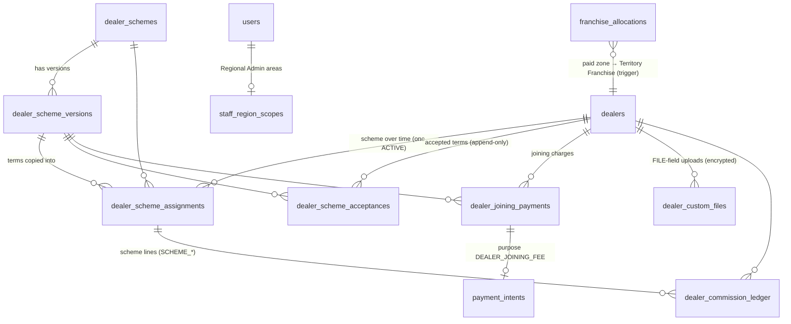

# GoKesari Dealership & Franchise Platform (built 23-Nov-2026)

Owner brief "Unified Dealership & Franchise Management Platform" (23-Nov-2026).
- **09.20 IST:** "Yes, use defaults" (decisions D1–D10, [PHASE_1_SCHEMES.md](PHASE_1_SCHEMES.md)).
- **09.40 IST:** "start all remaining phases do not wait for my approval / confirmations".

| Deliverable (brief §17) | Where |
|---|---|
| 1. Existing system gap analysis | [GAP_ANALYSIS_2026-11-23.md](GAP_ANALYSIS_2026-11-23.md) (+ xlsx in the owner's Devlopment_Trackers folder) |
| 2. Unified target architecture | §1 below |
| 3. Existing-to-new module mapping | §2 below |
| 4. Database ERD | §3 below |
| 5. Data migration plan | §4 below |
| 6. API specifications | §5 below |
| 7. Commission calculation specification | §6 below |
| 8. Dynamic scheme configuration specification | §7 below |
| 9. Admin user guide | [ADMIN_GUIDE.md](ADMIN_GUIDE.md) |
| 10. Dealer user guide | [DEALER_GUIDE.md](DEALER_GUIDE.md) |
| 11–12. Testing documentation, test execution report | [TEST_REGISTER.md](TEST_REGISTER.md) (+ xlsx in Test_Cases_Tracking) |
| 13–14. Deployment plan, rollback plan | §8 below |
| 15. Technical documentation | this file + the phase notes + code headers |

## 1. Architecture: one engine on the existing records

The existing dealer, franchise, ledger and payout code stays. Schemes sit on top of it, and one calculator is added. There is no parallel module.

| Engine (brief §3) | What it is |
|---|---|
| **A. Commercial scheme engine** | `dealer_schemes` → `dealer_scheme_versions`. Terms are versioned JSON validated by `schemeTermsSchema` in `src/lib/dealer-schemes.ts`. Published terms cannot change (enforced by a DB trigger). |
| **B. Dealer management** | The existing `dealers` row. `dealer_scheme_assignments` records each dealer's scheme over time: a copy of the terms, their SHA-256, and when, from where (IP) and on what device the dealer accepted them. One registration form covers every scheme (`/dealer/apply`). |
| **C. Territory management** | The existing franchise zones, booking, allocation, renewal and expiry. The **Territory Franchise** scheme wraps them. A paid allocation moves the dealer onto that scheme, and the end of the allocation moves him back (both by trigger). |
| **D. Commission engine** | `src/server/dealers/scheme-calculator.ts`, built on the pure maths in `src/lib/dealer-scheme-math.ts`. It writes to the existing `dealer_commission_ledger` with accrual keys. The legacy models still run for dealers whose terms say `LEGACY_*`. |
| **E. Financial engine** | Joining charges go through the existing payment gateway (`DEALER_JOINING_FEE`), with GST. A rejected applicant is refunded through the gateway. The existing monthly close, holds, reversals, TDS, payouts and statements are reused. |
| **F. Admin configuration** | The scheme builder, custom fields, a safe formula engine (`src/lib/dealer-formula.ts`, no `eval`), the simulator, versions and compare, scheduled launch, and maker-checker through the generic approvals engine. |

## 2. Existing → new mapping

| Existing | In the platform |
|---|---|
| Free dealer (STANDARD 40% / milestone rules / TIERED 20-4-3) | **Free Dealership v1** (`LEGACY_DEALER`). Existing dealers stay on it (D8). |
| Brief's free terms (20% + 5% monthly) | **Free Dealership v2** (`SCHEME`), from migration 0179; superseded on 25-Nov-2026 |
| Owner 25-Nov-2026 (D1): 20% one-time only | **Free Dealership v3** (`SCHEME`). New dealers get it from migration 0190; v2 dealers move to it. Business / Growth Partner suspended (D2). |
| — | **Business Partner** (₹11,000 + GST) and **Growth Partner** (₹21,000 + GST), both `SCHEME` |
| ₹1.5 lakh franchise (Model B, `franchise_config_versions`) | **Territory Franchise v1** (`LEGACY_FRANCHISE`; amounts follow Franchise settings) |
| Retired pincode territory dealer | Left as it is (off, no data); to be removed later |
| 3-level team (`dealer_salespeople`) | Used for the TEAM_OVERRIDE levels of team-building schemes. A dealer an admin moves to TIERED keeps that model. |
| Dealer agreement version (latest only) | Plus `dealer_scheme_acceptances`: every acceptance of scheme terms (append-only) |
| ADMIN-only checks | Permissions: `DEALER_SCHEME_EDIT`/`_PUBLISH`, `DEALER_APPROVE`, `DEALER_SUSPEND`, `DEALER_REASSIGN`, `DEALER_TERRITORY_ALLOCATE`, `DEALER_COMMISSION_EDIT`, `DEALER_PAYOUT_APPROVE`, `DEALER_REFUND`, `DEALER_PLATFORM_VIEW`. Six new roles hold them. |

## 3. ERD (new tables and links)

Columns added:
- `dealers.logo_url`, `requested_version_id`, `custom_values`;
- `dealer_commission_ledger.scheme_assignment_id`, `scheme_component_id`.

Migrations, each with a `scripts/rollback-NNNN.sql`:

| Migration | Phase |
|---|---|
| 0177 | P1 schemes and logo |
| 0178 | P2 registration and joining fee |
| 0179 | P3 calculator, publishes the brief schemes |
| 0180 | P5 custom fields |
| 0181 | P6 roles, regions, four-eye flag |

## 4. Data migration

Production had 1 dealer, 0 franchise bookings, 0 ledger rows and 0 payouts when this was built.

**Mapping:** every existing non-internal dealer goes to Free v1, or to Territory Franchise v1 if he has a paid zone. The source is `MIGRATION`, with a copy of the terms. Nothing else is moved: dealer IDs, codes, attribution, ledger, payouts and payments stay in place, and no historical row is changed.

**Controls (brief §16):**
- **No loss and no duplicates:** inserts only; one ACTIVE assignment per dealer (unique index); the ledger keeps its accrual keys.
- **Paid history unchanged:** no ledger row is touched.
- **Reconciliation query** (run after the migrate):
  - `select count(*) from dealers where not is_internal`
  - `= select count(*) from dealer_scheme_assignments where status='ACTIVE'`
- **Rollback:** the rollback scripts, newest first. Legacy tables are not dropped.

## 5. API

| Method | Path | Who | Purpose |
|---|---|---|---|
| GET/POST | `/api/dealer/application/scheme` | applicant | offered schemes and the joining charge / choose a scheme |
| POST | `/api/dealer/application/scheme/pay` | applicant | open the gateway payment for the joining charge |
| POST | `/api/dealer/application/submit` | applicant | `{ agreementVersion, termsHash }`: submits and records the acceptance |
| GET/PUT | `/api/dealer/application/custom-fields` | applicant | the scheme's questions / save answers |
| POST | `/api/dealer/application/custom-fields/file` | applicant | upload for a FILE question |
| GET | `/api/dealer/custom-files/[id]` | owner, staff | download (audited for staff) |
| GET/POST | `/api/dealer/scheme/change` | approved dealer | schemes he can move to / accept one, pay if it has a charge |
| POST/DELETE | `/api/dealer/logo` | dealer | dealer logo (flag `shop_logo_upload_enabled`, by his district) |
| GET/POST | `/api/admin/dealer-schemes` | staff / SCHEME_EDIT | list / create (blank or clone) |
| POST | `/api/admin/dealer-schemes/[id]` | SCHEME_EDIT / _PUBLISH | `saveDraft`, `publish` (now or scheduled), `status`, `deleteDraft`, `compare`. Answers 202 when four-eye is on. |
| POST | `/api/admin/dealers/[id]/scheme` | DEALER_REASSIGN | move a dealer to a version he accepted (four-eye) |
| POST | `/api/admin/franchise/bookings/[id]/refund` | DEALER_REFUND | refund a booking (four-eye) |
| GET | `/api/admin/dealer-dashboard` | dealer staff | dashboard JSON, or `&format=csv` |

Job: `dealer-scheme-launches`, every 5 minutes (`src/server/cron/schedule.ts`).

## 6. Commission calculation

The functions are pure, in `src/lib/dealer-scheme-math.ts`, and the live calculator and the simulator share them.

- **Fee base:** the registration fee paid, before GST and after any coupon (`feeBasePaise`). A waived fee earns nothing.
- **One-time (at shop activation):**
  - A `ONE_TIME` component is `rate × base`, a fixed amount, or a formula.
  - **Payee:** the signer when the scheme allows team building, else the dealer.
  - `TEAM_OVERRIDE` level 1 pays the first person above the signer, level 2 the second; placement is taken on the shop's registration date.
  - **Budget:** if `commissionBudgetBp` is set, all one-time lines on a shop are scaled down to `fee × budget`, and the lines are noted.
- **Monthly (at the month close, before approval):** for each active SCHEME assignment and each MONTHLY component, on each of the dealer's activated shops:
  - the base is GoKesari's actual commission (`order_financials.commission_paise`) on orders delivered that month, minus the refunds recorded that month (pro rata), or the sales (gross or net) if the component says so;
  - it is paid while `monthsSinceActivation < durationMonths` and the scheme's `validityMonths` has not run out.
- **Ledger:** one line per accrual key:
  - one-time: `SO:<assignment>:<component>:<shop>`;
  - monthly: `SR:<assignment>:<component>:<shop>:<YYYY-MM>`.
  - Entry types are `SCHEME_ONE_TIME`, `SCHEME_TEAM`, `SCHEME_RECURRING` and `SCHEME_BONUS`.
  - The existing holds (dealer not approved, documents, agent agreement), reversals (a fee refund reverses every line for the shop), approval, payouts, TDS and statements apply.
- **Precedence:**
  1. Franchise Model B inside a paid zone.
  2. A dealer moved to TIERED by an admin.
  3. A shop already on the standard model.
  4. Otherwise, SCHEME calculation when the dealer's terms say so; legacy otherwise.

## 7. Scheme configuration

The terms are a JSON document (`schemeTermsSchema`):

| Field | Contents |
|---|---|
| `summary` | text |
| `calculation` | `SCHEME` / `LEGACY_DEALER` / `LEGACY_FRANCHISE` |
| `charge` | free, one-time, monthly, quarterly, annual, instalments, refundable deposit or custom; amount; GST rate and whether it is inclusive or exclusive |
| `validityMonths` | — |
| `renewal` | — |
| `geography` | all India, state, district, city, zone or custom, plus area codes |
| `exclusivity` | none, shared or exclusive |
| `maxDealersPerTerritory` | — |
| `territoryBooking` | — |
| `teamBuilding` | — |
| `commissionBudgetBp` | — |
| `components[]` | kind (one-time, recurring, team, referral, target, renewal, development, performance); basis (registration fee, activation fee, GoKesari commission, sales, net sales, fixed per shop, formula); rate / fixed / formula; frequency; scope; level; duration; target |
| `customFields[]` | 12 types, condition, where used |
| `eligibilityRules[]` | formula and message |
| other | `benefits`, `eligibility`, `paymentConditions` |

**Validation:**
- one-time commissions on the fee add up to 100% or less, and stay within the budget;
- team commission needs team building;
- zone booking needs the ZONE geography;
- formulas compile against the allowed variables;
- a field's condition can only point to a field above it.

**Version lifecycle:**
- DRAFT → PUBLISHED, or WITHDRAWN.
- A PUBLISHED version becomes SUPERSEDED when the next one is published. Dealers keep the version they are on.
- A version with a future `effective_from` is scheduled: the scheme shows SCHEDULED, and the job publishes it at that time.

**Scheme status:**
- DRAFT → SCHEDULED or PUBLISHED.
- PUBLISHED ↔ SUSPENDED (no new dealers).
- EXPIRED and ARCHIVED.
- Free Dealership cannot be expired or archived.

## 8. Deployment and rollback

1. **Before opening the PRs:** #487 (RBAC 0171–0175) and #492 (logo card props) are on `origin/staging`.
   - Rebase onto staging; the local base commits drop out.
   - Renumber the migrations to the next free numbers, and check the journal (`migration-journal.test.ts`).
2. **One PR into `staging`,** labelled `ready-for-staging`. The staging queue runs CI, the migration, the deploy, the post-deploy check and guest QA.
3. **Production:** this goes out as one joint release with the logo work (#489/#490/#492), released by the CF-011 session (owner, 09.26 IST: "Release at once").
   - Run `prod-db migrate` first.
   - After the merge, run the post-deploy check.
4. **Flags on production after release:**
   - `shop_logo_upload_enabled`: OFF;
   - `dealer_platform_four_eye`: OFF (switch it on once a second admin exists).
5. **What changes for real users at release:**
   - new dealers start on Free v2, with 20% one-time and 5% monthly;
   - Business Partner and Growth Partner are open for applications.
   - Since migration 0190 (owner, 25-Nov-2026): Free v3, 20% one-time only; Business / Growth Partner suspended.
   - Existing dealers are unchanged.
6. **Rollback, step by step:**
   1. Suspend Business / Growth Partner in Admin → Dealers → Schemes. Applicants then see only Free.
   2. Publish a new Free version with `calculation: LEGACY_DEALER`, which restores the old calculation for new dealers.
   3. Revert the PR.
   4. Run the rollback scripts 0181 → 0177, newest first (`scripts/rollback-01xx.sql`).
