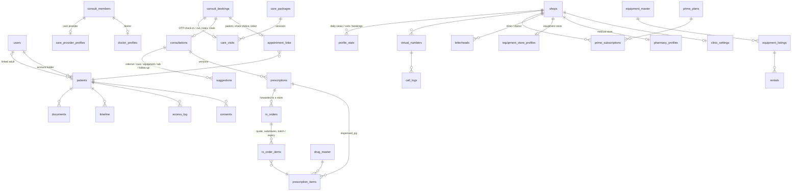

# GoKesari Health — data model

Migration `drizzle/0156_health.sql` (rollback `scripts/rollback-0156.sql`). All tables in schema **`health`**
except the consult tables they build on. Times are `timestamptz` (UTC), shown in IST. Money in paise.

| Table | Purpose | Key columns |
|---|---|---|
| `patients` | A person's record (SELF or family) | account_user_id, linked_user_id, relation, link_status (ACTIVE / PENDING_APPROVAL / REMOVED), allergies[], conditions[], **abha_number**, record_start_at, hidden_at |
| `consents` | Notice, record sharing, family link (DPDP) | kind, mode (ALWAYS / ASK / OFF / THIS_BOOKING), grantee_member_id, booking_id, version, text_snapshot, granted_at, revoked_at |
| `access_log` | Who viewed / printed / downloaded / shared (patient-visible) | actor_label, actor_role, action, object_type, object_id, reason |
| `doctor_profiles` | Council registration for prescriptions | member_id, council, registration_number, registration_year, qualifications, specialties[], **hpr_id**, signature / stamp (encrypted) |
| `care_provider_profiles` | Home-care provider details | member_id, provider_kind, care_categories[], registration, police_verification, service_pincodes[], id_card_number |
| `pharmacy_profiles` | Medical store eligibility | drug_licence_number, pharmacist_name, pharmacist_registration_number, verification |
| `equipment_store_profiles` | Equipment store terms, verification | rental_terms, damage_policy, verification |
| `clinic_settings` | Token mode, follow-up window, **hfr_id**, pay-per-booking | |
| `letterheads` | Print settings per clinic / doctor | mode, paper, margins (mm), header / footer / background images, sections, local_language, auto_print |
| `drug_master` | Generic / brand / strength / form; schedule; **tele_list** (O / A / B / PROHIBITED); online_sale_allowed | |
| `icd10_codes` | Diagnosis search | code, title |
| `appointment_links` | Health side of a consult booking | patient_id, share_records, visit_type, token_number, queue_order, called_at, referral_suggestion_id, walk_in |
| `consultations` | The pad | vitals jsonb, complaints, history, examination, diagnoses jsonb (code, text), investigations, advice, follow_up_date, status |
| `prescriptions` | Versioned e-prescriptions | rx_number, version, root_id, supersedes_id, amend_reason, status (ISSUED / SUPERSEDED), content (frozen), pdf (encrypted), pdf_hash, verification_token, valid_until |
| `prescription_items` | Medicine lines | drug_id, dose, frequency, timing, duration_days, quantity, instructions(+local), tele_list, **dispensed_qty ≤ quantity** |
| `suggestions` | Doctor's referral / care / equipment / lab / follow-up | type, details, target_member_id, urgency, print_on_rx, share_records, status, linked booking / order / rental — **no money fields** |
| `documents` | Reports, scans, bills, visit notes (encrypted) | source (DOCTOR / LAB / PATIENT / PROVIDER / STORE / SYSTEM), kind, document_date |
| `timeline` | Denormalised feed per patient | occurred_at, kind, title, summary, provider, ref_type / ref_id |
| `events` | Outbox of every health event (ids and statuses only) | name, user_ids[], shop_id, subject_id, payload |
| `share_links` | Expiring links to one item | token_hash, expires_at, open_count |
| `rx_templates` | Doctor's templates / favourites | |
| `rx_orders`, `rx_order_items` | Prescription → store: request, quote, approval, payment, pickup / delivery codes, bill | status, expires_at, totals, payment, commission, otp_salt, batch / expiry, dispensed_qty |
| `care_visits`, `care_packages` | Home-care visit lifecycle and session packages | status, on_the_way / checked_in / checked_out, otp_salt, notes, vitals, sos_at; sessions_total / done |
| `equipment_master`, `equipment_listings`, `rentals` | Equipment for sale / rent and the rental lifecycle | deposit, period, due_date, delivery code, extensions, damages, deposit refund |
| `prime_plans`, `prime_subscriptions`, `prime_coupons` | Listing plans (admin-priced), purchases, coupons | features / quotas / prices jsonb, term, GST, invoice_number, grace_until |
| `virtual_numbers`, `call_logs`, `profile_stats` | Prime call tracking and analytics | |
| `data_requests` | DPDP export / delete requests | |
| `counters` | Number series (RX-<year>, MED-<year>, RENT-<year>, PRIME/<FY>) | |

**FHIR mapping (ABDM phase 2):** patients → Patient (ABHA), doctor_profiles → Practitioner (HPR), clinic shop +
clinic_settings → Organization (HFR), consult_bookings → Appointment / Encounter, consultations → Encounter +
Condition (diagnoses, ICD-10) + Observation (vitals), prescriptions / items → MedicationRequest, documents →
DocumentReference / DiagnosticReport, suggestions → ServiceRequest.

Existing tables changed: `payment_intents.purpose` check gains `HEALTH_RX_ORDER`, `HEALTH_RENTAL`, `HEALTH_PRIME`;
`consult_categories` gains five home-care categories (group "Home care").
