# GoKesari Health — testing report

| | |
|---|---|
| Build | PR #429, branch `feat/gokesari-health` (on consultant appointments #425; merged with Puja Samagri #427, so the migration is `0156_health`) — merged into `staging` 20-Nov-2026 19.41 IST as `a73d7a0f` |
| Report date | 20-Nov-2026 (all times IST) |
| Environments | **Local** (PostgreSQL 18, Next.js dev and production builds): run. **Test** (test.gokesari.com): deployed 20-Nov-2026 19.46 IST, staging-verified 20.40 IST. **Prod** (gokesari.com): joint release as soon as every PR in it is staging-verified (owner, 20-Nov 16.50); Health switched **on** at launch by the migration (owner, H-47). |
| Prepared by | Claude (lead engineer session) |

## 1. Summary

| Environment | Suites | Cases | Passed | Failed | Not run | When (IST) |
|---|---|---|---|---|---|---|
| Local — Health integration (6 suites) | 6 | 55 | 55 | 0 | 0 | 20-Nov-2026 12.19 – 12.30 |
| Local — consultant appointments (base engine) | 1 | 26 | 26 | 0 | 0 | 20-Nov-2026 12.19 |
| Local — full regression (all unit + integration tests in the repo) | 293 | 3,646 | 3,646 | 0 | 0 | 20-Nov-2026 12.21 – 13.08 (fresh database, every migration up to Health; renumbered 0154 at 13.11 after newspapers took 0152 and consult 0153 — same SQL) |
| Local — UI smoke (19 key screens, phone + desktop, signed in as patient / doctor / admin) | 1 | 19 | 19 | 0 | 0 | 20-Nov-2026 12.22 |
| Local — after merging staging (newspapers #423) + consult: all unit tests + Health, consult and newspaper integration suites, fresh database with migrations up to 0154_health | 97 | 1,224 | 1,224 | 0 | 0 | 20-Nov-2026 13.12 – 13.14 (one tile-count assertion updated for the merged menus) |
| Local — QA guest checks TC-HLT-001…005 (Playwright, desktop + phone) | 1 | 5 | 5 | 0 | 0 | 20-Nov-2026 12.53 – 12.59 (TC-HLT-005 timed out once in a combined run while the dev server compiled ~70 routes; passes alone) |
| Local — live update latency (booking → doctor's Today stream) | 1 | 1 | 1 | 0 | 0 | 20-Nov-2026 12.40 (0.51 s) |
| Local — after merging Puja (#427): fresh database, migrations 0000–0156 in order; tsc; all unit test files; 203 integration tests (Health, consult, newspapers, subscriptions, Puja, migration journal, tile board) | 102 | 1,290 + 203 | all | 0 | 0 | 20-Nov-2026 16.45 – 16.51 (first pass failed only because the fresh database had not been migrated) |
| Local — QA access checks (TC-RBAC-002, TC-SEC-001) against a local production build | 2 | 20 | 18 | 2 | 0 | 20-Nov-2026 18.25 (the 2 failures are local only: dealer rules off locally, /puja before #437, DigiLocker webhook without keys; no Health route) |
| GitHub CI on PR #429 (typecheck, lint, all unit + integration tests, production build at 6 GB) | 1 | all | all | 0 | 0 | 20-Nov-2026 18.48 – 19.30 (head `3b2e2a28`) |
| Test — staging queue: CI, migration 0156 on the test database (backup snapshot first), deploy, site kept answering, guest QA tier | 1 | — | Pass | 0 | — | 20-Nov-2026 19.41 – 20.40 (`staging-verified`) |
| Test — Health guest checks TC-HLT-001…005 (Playwright) | 1 | 10 | 7 | 0 | 3 | 20-Nov-2026 19.50 (3 = phone repeats of API-only checks, skipped by design) |
| Test — signed-in smoke: customer (notice, record, records / access log / consents APIs, 13 My Health pages at 390 px, live stream, admin refused), guest APIs, shop owner (menu, hub), admin (7 data views, page) | 1 | 36 | 36 | 0 | 0 | 20-Nov-2026 19.50 (the customer's `/admin/health` shows the in-page "Not allowed (403)", counted as refused) |
| Test — full regression of all modules (consult session) | 1 | 2,358 rows | 656 | 12 (known / test data) | 194 blocked, 697 local-only | 20-Nov-2026 16.03 – 18.09, before Health was merged |
| Prod (gokesari.com) — post-deploy check + guest smoke TC-HLT-001…005 | — | 5 | — | — | 5 | pending the joint release |

Pass rate: **Local 100%** (3,646 / 3,646 in the full regression, which includes the 55 Health and 26 consult cases); Test and Prod not run yet (see §6).

Also checked locally: `npx tsc --noEmit` clean (except the pre-existing `barcode-scanner.tsx` error, caused only by `@zxing/browser` missing from this machine's shared `node_modules`); ESLint clean on all Health code; **production build** (`next build --webpack`, 8 GB heap) compiles and generates all 83 static pages and every Health route, 20-Nov-2026 13.08. Edits after 12.21 (print-only CSS, a link on closed consultations, customer tile entries, QA spec, docs) were re-verified by the tile test, type check, lint and the build.

## 2. What was tested (integration suites against real PostgreSQL)

| Suite | Cases | Covers |
|---|---|---|
| `tests/integration/health-core.test.ts` | 8 | Notice + consent text; family (dependent at once, adult by code; wrong code refused); verification gate (unverified doctor cannot be booked or prescribe); booking → Today (live event) → QR check-in (wrong QR refused) → consultation → issue: RX number, PDF `%PDF-`, SHA-256, e-mail queued with PDF attachment, booking COMPLETED, timeline / by provider / medicines, QR verification (public vs patient vs stranger), issue < 30 s; amend v2 + superseded + both kept; telemedicine (prohibited, List B), allergy warning + acknowledgement, auto quantity; consent-gated earlier records + access log + withdrawal; share link (expires) + full-record PDF; token clinic + queue position. |
| `tests/integration/health-rx-orders.test.ts` | 15 | Pickup with OTP; delivery with OTP; substitutes need approval (rejected drops); dispensed quantity never exceeds prescribed (sequential and racing); timeout expiry; sandbox online payment → PAID; cancellation refund; store cannot see prescriptions not sent to it; settlement 2%; Schedule X / NDPS refused; expired batches refused; 5-try code lock; partial supply refund; pharmacy re-verification. |
| `tests/integration/health-care.test.ts` | 7 | Book → accept → on the way → OTP check-in → OTP check-out with notes / vitals → record has the visit note and timeline → booking completed → rating; wrong OTP attempts; provider cannot see unshared records; SOS opens an urgent ticket. |
| `tests/integration/health-rentals.test.ts` | 6 | Rent with sandbox payment → deliver with OTP → active → due reminder → extension payment → return → damages → deposit refund minus damages → closed; prescription-required item refused without a prescription; stock. |
| `tests/integration/health-prime.test.ts` | 9 | Price from the admin plan (changed without code); GST 18%; coupon (expiry, use limits); purchase via sandbox → ACTIVE + invoice + virtual number + instant booking; renewal stacks; expiry → GRACE → EXPIRED → booking requests again, bookings untouched; webhook missed call → log + notification (replay ignored); pay-per-booking fee; ranking: Prime above an equal Free doctor and labelled, Free still listed, unverified never listed; city-scoped plan. |
| `tests/integration/health-admin.test.ts` | 10 | Customer / shop owner 403 on every admin API; operator verifies a pharmacy and cannot break glass; break-glass needs a reason, writes BREAK_GLASS to the access log + audit + notification; reports contain no clinical text; drug CSV import adds and updates; equipment master CRUD. |
| `tests/integration/consult-bookings.test.ts` | 26 | Base engine unchanged after the Health hooks (live push, 12-hour services). |

## 3. Acceptance criteria (brief §11)

| # | Criterion | Local result | Evidence | Test | Prod |
|---|---|---|---|---|---|
| 1 | Book a verified doctor (slot and token), pay online / at clinic; doctor sees it in Today within 2 s without refresh | Pass — **0.51 s** from the patient's booking request to the doctor's live stream (local dev server, 20-Nov 12.40 IST) | core: live event test; HTTP measurement through `/api/health/bookings` → `/api/health/stream`; token test; consult payments suite | Not run — needs a verified doctor / store / provider on staging | Not run |
| 2 | Unverified doctors / providers cannot be booked or prescribe | Pass | core "verification gate"; care search shows verified only; prime "unverified never listed" | Not run — needs a verified doctor / store / provider on staging | Not run |
| 3 | After Issue, within 30 s: PDF in timeline / by provider / medicines, e-mailed with PDF, ready to print | Pass | core issue test (asserts < 30 s, e-mail row + attachment render) | Not run — needs a verified doctor / store / provider on staging | Not run |
| 4 | Printing matches the letterhead mode; auto-print without a dialog | Pass (digital / standard / pre-printed rendering, calibration sheet); auto-print = Chrome kiosk printing — needs a person and a printer | screenshots 05, 50, 51; DOCTOR_GUIDE §4 | Manual | Manual |
| 5 | Three doctors + one nurse: all visits, diagnoses, prescriptions, medicines, notes, reports in date order per family member | Pass (timeline merges consultations, prescriptions, care visit notes, documents, per patient) | core + care suites | Not run — needs a verified doctor / store / provider on staging | Not run |
| 6 | Other providers' records only while consent is active; each view in the access log | Pass | core consent test | Smoke: access log + consents load | Not run |
| 7 | Prescription to store: pickup and delivery with OTP, substitutes need approval, bill linked, dispensed ≤ prescribed | Pass | rx-orders suite | Not run — needs a verified doctor / store / provider on staging | Not run |
| 8 | Suggestions on the prescription and in the app; each Book now links to a booking / order; no referral money to a doctor | Pass | core (suggestions, timeline); booking `suggestionId` links; rentals link; no money fields on suggestions | Not run (needs a verified doctor) | Not run |
| 9 | Home care: search → book → accept → OTP check-in / out → notes in record → rating | Pass | care suite | Not run — needs a verified doctor / store / provider on staging | Not run |
| 10 | Equipment: buy and rent incl. deposit, return pickup, deposit refund | Pass (rent); buy = normal order | rentals suite | Not run — needs a verified doctor / store / provider on staging | Not run |
| 11 | Prime: purchase, instant booking, labelled placement, call tracking, analytics, renewal, expiry downgrade; prices from admin | Pass | prime suite | Not run — needs a verified doctor / store / provider on staging | Not run |
| 12 | Patient referral codes and rewards, switchable by admin | Pass (existing customer-referral programme reused; its own tests in the regression) | full regression | Not run — needs a verified doctor / store / provider on staging | Not run |
| 13 | All existing GoKesari features still pass their tests | Pass — 293 files / 3,646 tests, 0 failures | full regression | Pass — staging CI + guest tier (20.40); full regression of all modules 16.03 – 18.09, no new defect | Post-deploy check |

## 4. Defects found and fixed during the build

| # | Found (IST) | Defect | Fix |
|---|---|---|---|
| D1 | 11.44 | Token number query passed JS `Date` objects to a raw SQL template → driver error | ISO strings with `::timestamptz` |
| D2 | 11.44 | Event count assertion picked up events from earlier tests (outbox not truncated) | Assertion scoped to the prescription |
| D3 | 12.15 | Free-listing rule made new bookings wait for approval, breaking consultations in tests | Tests switch the rule off explicitly; Prime suite covers the rule |
| D4 | 12.20 | Prescription page (server) imported button classes from a client module (would render a reference, not a class) | Classes moved to a plain module `components/health/styles.ts` |
| D5 | 12.20 | Two pharmacy verification paths (admin screen and store module) | Store-module routes removed; admin screen is the single path |
| D6 | 12.21 | "Packed" did not reach the patient's screen live | `order.packed` event added |
| D7 | 12.22 | Prime invoice numbers `PRIME/2026-27/000001` (20 chars) exceed GST Rule 46's 16 | `PRM/2627/000001` |
| D8 | 12.25 | Lint: refs written during render, impure `Date.now()` in render, effects setting state | Fixed / annotated as the consult screens do |
| D9 | 12.27 | Print view would print the site header / footer | Print CSS shows only the prescription |
| D10 | 12.27 | A closed consultation showed an empty medicines box | Link to its prescription |
| D11 | 12.24 | `/health/equipment` 404 on a long-running dev server (route added while running) | Not a code defect: fine after restart; production builds from scratch |
| D12 | 14.35 | The 28 Health cases were only in `tests/qa/catalog/cases.json`; the next export from `test-cases.xlsx` would drop them | Added through `plan_workbook.py add-json` (`docs/testing/manual/cases-added-2026-11-20-health.json`) |
| D13 | 15.15 | CI production build ran out of memory in its TypeScript step (Node's ~4 GB default on the runner) | CI build gets the server's 6 GB heap (`.github/workflows/ci.yml`); local peak 6.4 GB, server cap 7 GB — the staging build fit (19.46) |
| D14 | 18.25 | Public Health pages (Find a doctor, home care, equipment, care ID check) and the telephony webhook missing from the QA access lists — would fail TC-RBAC-002 on staging as /puja did (#427) | Added to `PUBLIC_PAGES` / `PUBLIC_WRITES` in `tests/qa/lib/routes.ts` before Health's turn |

## 5. Screenshots (local, demo data)

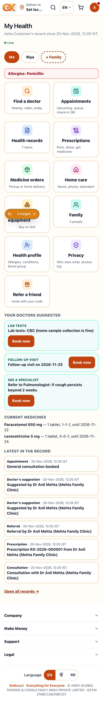 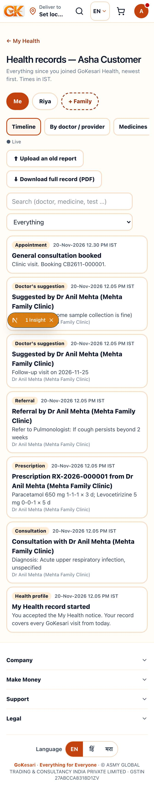
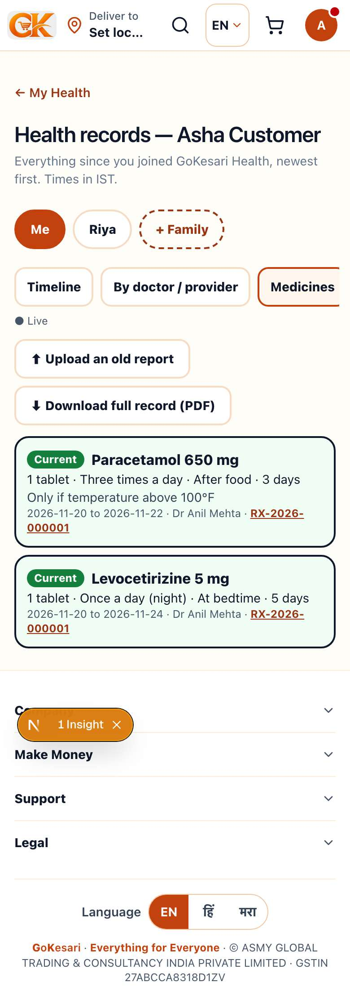 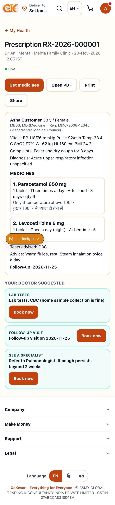
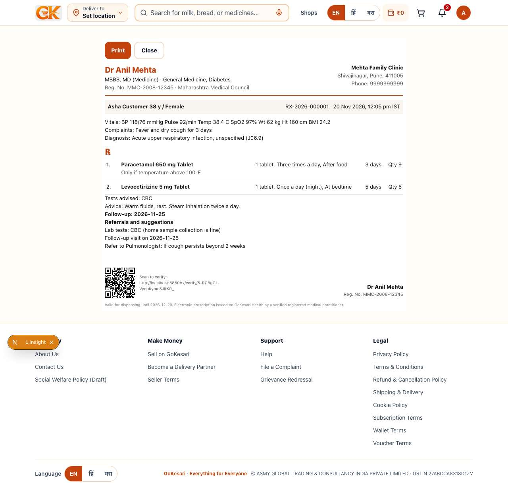 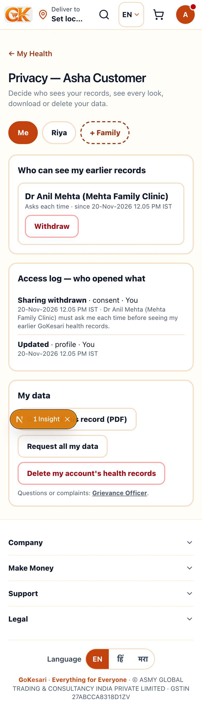
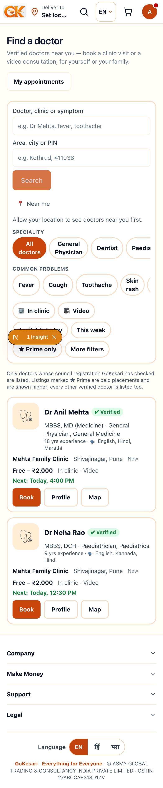 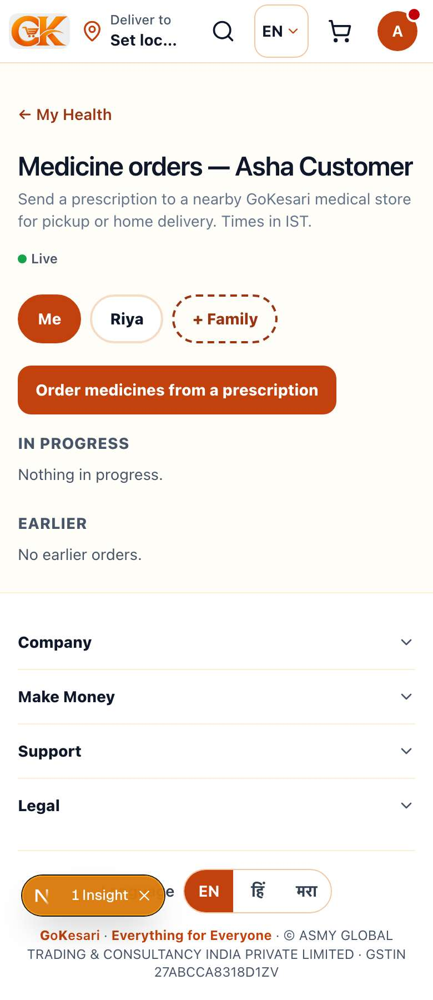
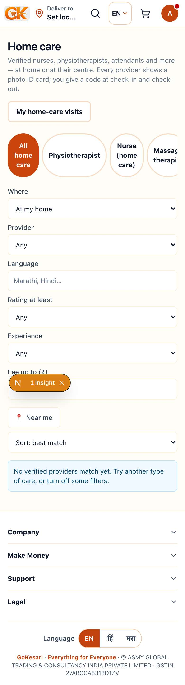 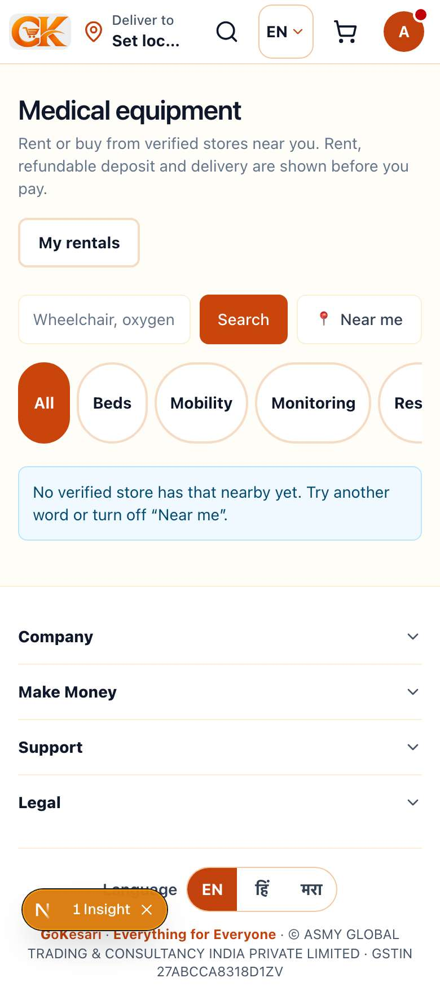
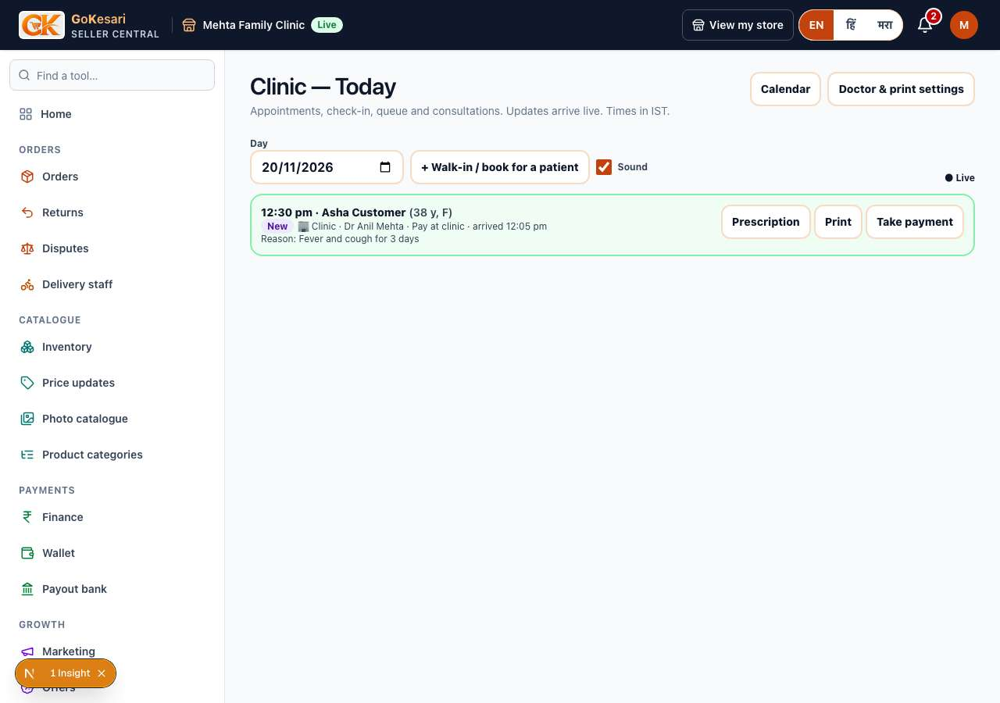 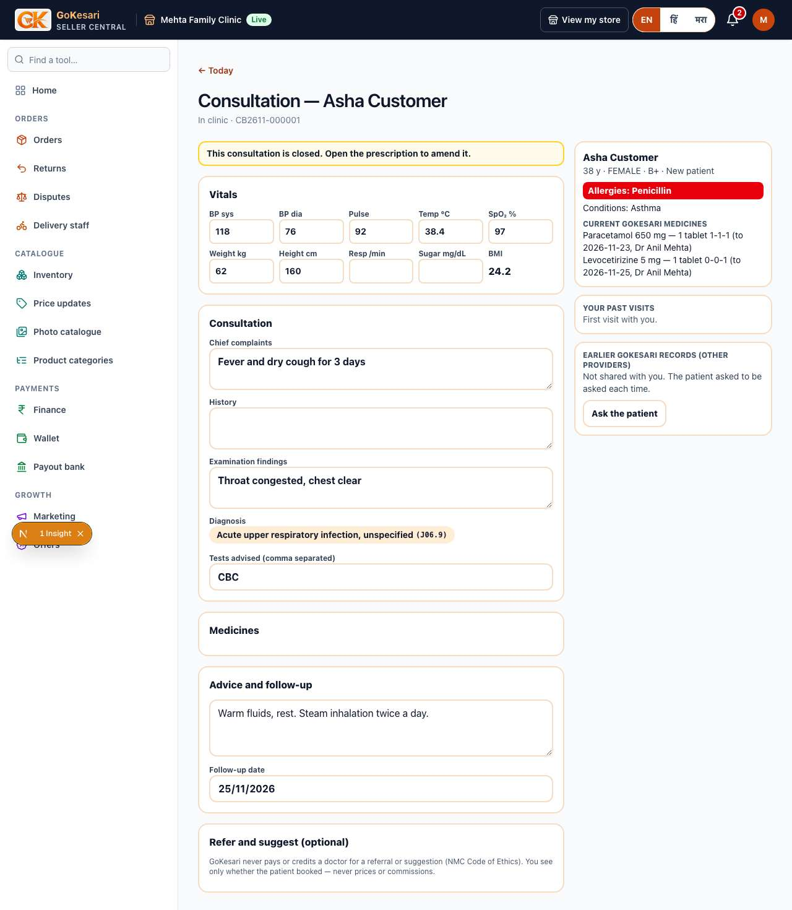
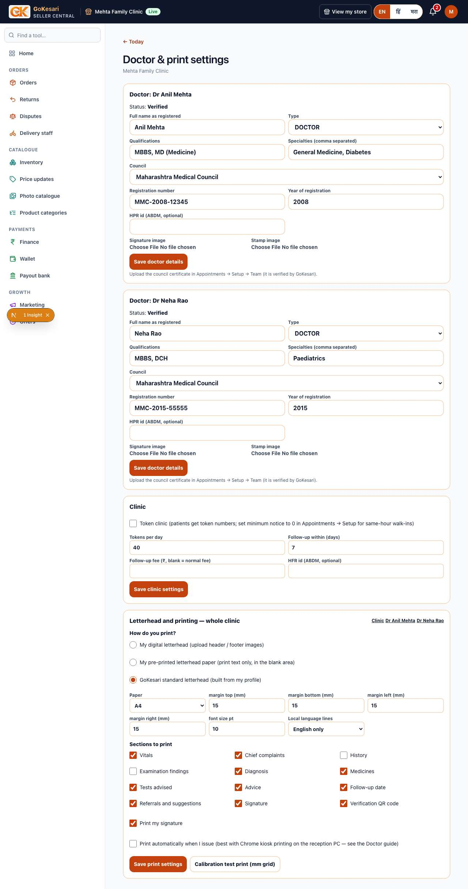 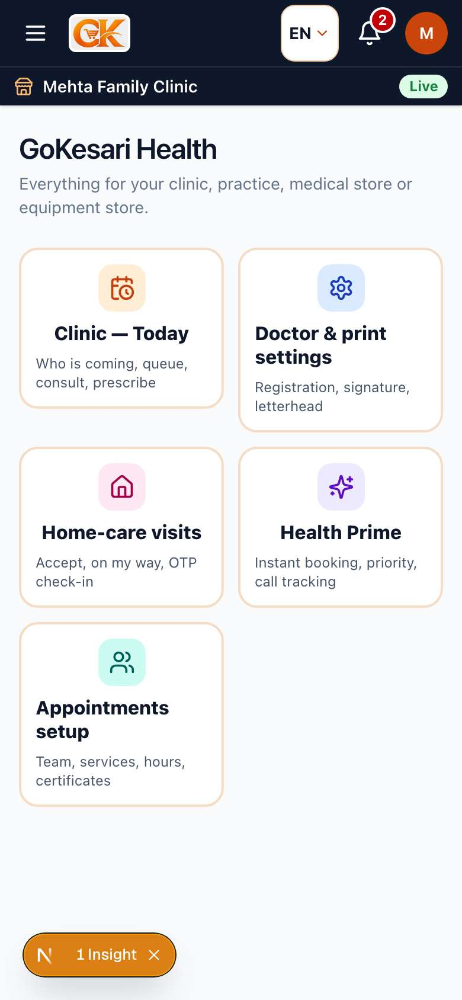
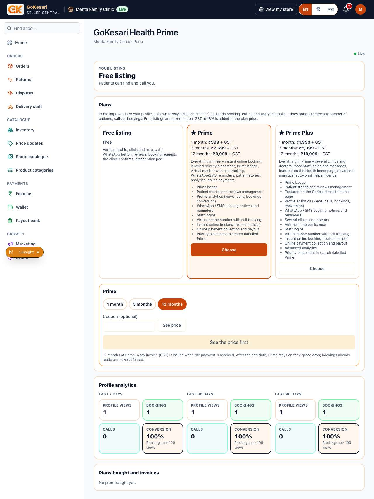 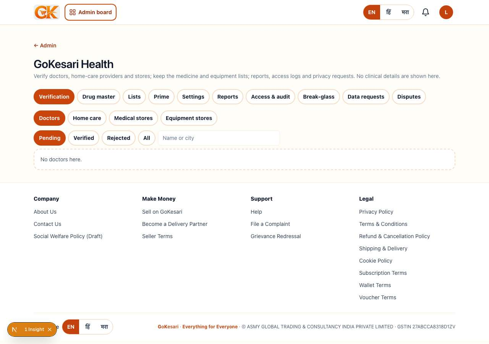
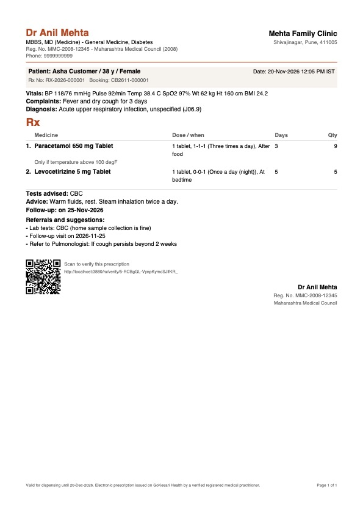 

## 6. Open items and what is needed

| Item | Status / owner input |
|---|---|
| Deploy to test.gokesari.com | **Done** 19.46 IST, staging-verified 20.40 IST; `health` and `consultBooking` on (migration). Still open on staging: the doctor / store / provider journeys TC-HLT-010…032 need a verified test doctor, store and care provider there (`scripts/health/demo-seed.ts` against the test database, or onboarding them through the app). |
| Deploy to gokesari.com | Joint release (newspapers, consultants, Puja, Health, tagline, welcome kit) as soon as all are staging-verified; production database migrated first (Production database workflow), then staging → main, post-deploy check, guest smoke TC-HLT-001…005. Health is **on** at launch (owner, H-47); legal and drug-list reviews remain recommendations. |
| Android / iOS 1.10.0 | APK built by CI on the PR; iOS via the manual "iOS" workflow (Apple secrets); store release and `MOBILE_APP_*_LATEST` = 1.10.0 by the owner. |
| Telephony (Prime virtual numbers), SMS / WhatsApp vendor, PrintNode / QZ Tray for silent print | Accounts needed; mock / browser printing until then. |
| Legal review | Consent and notice text, retention, pharmacy and rental terms, Prime terms, break-glass. |
| Phase 2 | GoKesari rider delivery for medicine orders; dealer commission on Prime sales; GoKesari Health Plus membership; ABDM linking; two-way Google Calendar sync. |
