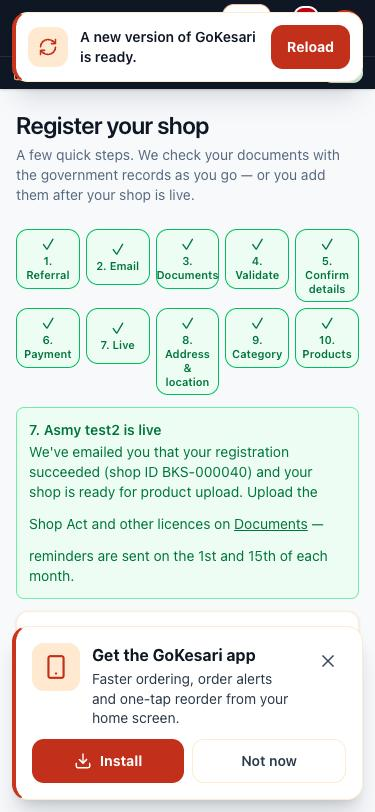
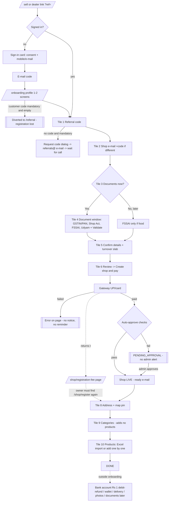

# Shop onboarding — current flow (as built)

Audit date 05-Nov-2026, 23.15 IST. Phase A, read-only: no code was changed.
Companion docs: [competitor-benchmark.md](competitor-benchmark.md) · [gap-analysis.md](gap-analysis.md) ·
[proposed-flow.md](proposed-flow.md).

**Sources.** The code at `7c4bf638` (branch `fix/billing-v2-d118-d119`) plus the working tree. Items that
exist only in another session's uncommitted "shop refers shop" work (PR 325) are marked **[uncommitted]**.
Walked on test.gokesari.com on 05-Nov-2026 at 375 × 812 (screens `/sell`, `/shop/register` with a
completed shop, `/referral`); earlier staging runs are in
[TEST_RESULTS_single_flow_2026-10-30.md](../shop-onboarding-wizard-2026-10/TEST_RESULTS_single_flow_2026-10-30.md).
A fresh signed-out walk with a new account was **not** done in Phase A; it is the first test in Phase B.
Production (gokesari.com) was not walked.

## 0. Which flow a visitor gets

Everything depends on the feature flag `shop_onboarding_wizard_enabled` (seeded **off**;
`src/server/services/shop-registration-wizard.ts:118-135`).

- **On** (test.gokesari.com since 30-Oct): the 10-tile wizard below.
- **Off**: the older long form `ShopRegisterForm`; admins can still open the wizard with `?wizard=1`.
- **Production state: unconfirmed** — to be read from Admin → Feature flags before Phase B.

## 1. Entry points

| Entry | Status | Where |
|---|---|---|
| Self sign-up from `/sell` → "Register your shop" | Yes | `src/components/seller/register-options.tsx`, `src/app/sell/page.tsx` |
| Dealer / sales-executive link `/shop/register?ref=CODE` (+ WhatsApp share, QR) | Yes; code pre-fills tile 1 | `src/server/dealers/codes.ts:214-222` |
| `/r/CODE` short link | Customer referral only; a dealer code sent this way never reaches shop registration. **[uncommitted]** `SHOP…` codes forwarded to `/shop/register` | `src/app/r/[code]/route.ts` |
| Dealer-assisted (dealer fills, owner consents with emailed code, owner pays later) | Yes, behind `dealer_programme_enabled` | `src/server/dealers/assisted.ts` |
| District distributor (Module 3) | Legacy. `/shop/join?code=` just forwards to `/shop/register?ref=`; distributor commission is **not** written for wizard shops (inferred) | `src/app/shop/join/page.tsx`, `src/server/registration/service.ts` |
| Admin / operator on behalf of an owner | Yes, `/operator/onboard` (ADMIN, OPERATOR_LIMITED; not plain OPERATOR) — owner's emailed code → form → pay link | `src/components/batch-d/onboard-wizard.tsx`, `src/server/services/operator-limited.ts` |
| Existing owner registers a 2nd shop | **Missing in the wizard** — the page keeps showing the first shop's draft; no "add another shop" control | `shop-registration-wizard.ts:404-414` |
| Signed-in customer becomes a seller | Yes, same account | `src/app/shop/register/page.tsx:69-73` |
| User whose active role is DEALER | Blocked — step 1 fails "no permission" (no `SHOP_CREATE`) | — |

## 2. Screens on the happy path (wizard on)

| # | Screen | Fields (R = required, O = optional, P = pre-filled) | Notes |
|---|---|---|---|
| 0a | Sign-in card on `/shop/register` | Terms consent R; mobile or e-mail R; 6-digit code R (always by **e-mail** — SMS not set up); Google as an option | Unknown mobile also asks for an e-mail |
| 0b | `/onboarding` profile (first sign-in only, 2 screens) | Name, gender, mobile O; customer referral code; delivery address (skippable) | **Risk:** if the customer referral code is mandatory, a new shop owner is sent to `/referral` and loses the registration |
| 1 | Tile 1 Referral | Code R/O by admin toggle `referral_required_shop` (default optional) | "Request Referral Code" dialog: name, mobile, shop type, area, city, PIN, browser location → e-mail to referrals@gokesari.com + SUPPORT in-app notice; 1 per mobile per 24 h |
| 2 | Tile 2 Shop e-mail | Use account e-mail, or another e-mail + 6-digit code | |
| 3 | Tile 3 "Documents now?" | Yes / No | No = "upload later" path |
| 4 | Tile 4 Document window | Consent R; GSTIN R (or PAN + no-GST declaration); Shop Act O; FSSAI O (R for food); Udyam O — each with Validate | Type or scan (on-device OCR, English). GSTIN check pre-fills shop name, legal name, owner (proprietors), address, PIN; **city and state not filled**. 10 paid checks / draft / hour. Provider: mock (default) / Gridlines / Sandbox.co.in — **production provider unconfirmed** |
| 5 | Tile 5 Confirm details | Shop name R P; owner R P; shop mobile R; shop type R; address R P; city R; PIN R P; turnover slab R; line 2 / area / landmark / coupon / helper O | No state field (state is always empty on wizard shops) |
| 6 | Tile 6 Review → "Create my shop and pay" | — | Creates shop PENDING_APPROVAL |
| 6b | Gateway (UPI / card) | — | `PAYMENT_GATEWAY` (staging SANDBOX) |
| 7 | `/shop/registration-fee?shop=` | — | **Gateway returns here, not to the wizard**; offers "Go to my shop" / "Upload documents". Tiles 8–10 are easy to miss |
| 8 | Tile 8 Address & map pin (after approval) | Address R P, city R P, PIN R P, pin on map | Shop waiting for admin cannot set the pin. Staging Maps key refused (owner action from 30-Oct) |
| 9 | Tile 9 Category | ≥ 1 *shop* category | **Adds no products.** Correction (05-Nov-2026, 23.55 IST): the "auto-add at stock 100" does exist — adding a *product* category in Seller Central lists all its products at MRP with stock 100 (`fillInventoryFromCategory`, rule `catalogue.categoryFillStock`). The wizard sets *shop* categories, a different list, so nothing is listed from the wizard |
| 10 | Tile 10 Products | Links to Excel import or product manager | Add = product + price + stock; **no MRP field** for the shop |

**Fees (as built).** Turnover slabs, not shop type: up to ₹2 crore **₹999 + GST**, up to ₹10 crore
₹4,999 + GST, above ₹9,999 + GST (`src/lib/registration-fee.ts:33-37`, admin-editable). The brief's
**₹1,000 shop / ₹2,500 wholesale** fees do not exist in code. The fee also starts a 12-month membership
while the copy says "one-time".

**Approval.** On fee capture (signed webhook) wizard shops are auto-approved in every district when:
GSTIN/PAN verified by the source (not a reviewer, not the mock in production), active, name score ≥ 85,
PAN matches GSTIN, fee paid online, no likely duplicate, FSSAI for food. Otherwise PENDING_APPROVAL
with reasons in `shop_auto_approval_log` (`/admin/shops/instant-approvals`).

**"Upload later" path.** Tile 3 No → details → (FSSAI if food) → review → pay → live. Payouts held
(`PAYOUT_HELD`) until GSTIN or PAN verified; reminders 1st and 15th by daily cron; auto-suspend after the
3rd reminder. Copy says 30 days, rule `promiseDays` is 90.

**Outside onboarding altogether:** bank account (`/shop/bank-account`, ₹1 **debit-and-refund** check by
UPI / card / net banking through Cashfree, not a penny-drop credit; rule off by default; payouts not held
for an unverified bank by default), prepaid wallet (`shopWallet` off by default, ₹200 minimum), delivery
set-up (`delivery_available` false, 5 km radius), photos, MRP, store QR / share link. Drug licence and
medical registration exist only in rule `legalDocuments` (off) on `/shop/legal-documents`.

## 3. Measurements

Happy path: GST-registered, non-food shop, wizard on, referral optional, dealer programme off.

| Measure | Existing customer | Brand-new user |
|---|---|---|
| Screens to "shop live" | **9** | **≈ 12** (sign-in 2–3 states + profile 2) |
| Screens to first product listed | **≈ 13** | **≈ 16** |
| Required inputs to payment | ≈ 10 (3 pre-filled) | ≈ 13 + |
| Optional inputs shown before payment | ≈ 8 | ≈ 12 |
| Taps to live (estimate) | ≈ 25–30 | ≈ 35–40 |
| Estimated time to live (GSTIN verifies instantly, UPI pay) | **≈ 6–8 min** | **≈ 9–12 min** (e-mail code wait) |
| Estimated time to first product | + 3–5 min (search product, type price & stock per item) | same |
| Time to 10 products | ≈ 10–15 min one by one; Excel import faster only if the owner has a sheet | — |

Times are estimates from the screen count and the 30-Oct staging walk; no instrumented timing exists.

## 4. Drop-off risks (highest first)

1. Gateway return skips tiles 8–10; Seller Central has no "finish set-up" checklist.
2. New user diverted to `/referral` by the mandatory customer code during `/onboarding`.
3. Shop referral code mandatory on staging with no instant way to get one (request → wait for a call).
4. Sign-in code by e-mail only — many kirana owners use mobile, not e-mail.
5. Shop e-mail step and "documents now?" question add 2 screens before any value.
6. Paid-but-pending shop gets no timeline and admin gets no alert.
7. Failed wizard payment: no notice to the owner, no reminder.
8. English-only wizard although `/sell` promises हिन्दी / मराठी.
9. Choosing a category in the wizard adds no products (it sets shop categories, not product categories), so the shop is live but empty.
10. Abandoned drafts never marked or chased (`ABANDONED` status unused).

## 5. States, language, accessibility

- **Save & resume:** every step saved server-side (`shop_registration_drafts`, seller DB); resumes at
  `nextStep`. No draft expiry, no abandon reminder, no admin view of drafts.
- **Progress:** 10-tile board with "Step X of 10" (screen-reader). No "minutes left".
- **Errors:** duplicate shop (409), rate limit, identity not verified, payment failed, map key failure →
  coordinates fallback.
- **i18n:** Seller Central board in EN/HI/MR via cookie; **wizard, sign-in, referral dialog, scan: English
  only**.
- **Accessibility:** good tap targets (≥ 44 px), `aria-current="step"`; but alerts have no `role="alert"`,
  errors not tied to inputs, focus not moved on step change, tile labels 11 px.

## 6. Notifications by state change

Event-driven (`emitEvent` / `notify`), delivered at once; cron only retries failed deliveries. Push off by
default; SMS / WhatsApp providers are none or mock.

| State | Owner | Dealer / referrer | Admin / support |
|---|---|---|---|
| Referral code requested | — | — | e-mail referrals@ + SUPPORT in-app |
| Draft started / step done / abandoned | — | — | — |
| Shop submitted | **none** | `DEALER_SHOP_ATTRIBUTED` | none |
| Fee paid | `SHOP_REGISTRATION_FEE_PAID` | — | **none when left pending** |
| Fee failed | **none** (wizard) | — | only operator sessions |
| Auto-approved | `SHOP_READY_FOR_PRODUCT_UPLOAD` (wording says GST/PAN verified even for upload-later) | `DEALER_SHOP_APPROVED` | `SUPPORT_SHOP_AUTO_APPROVED` |
| Manually approved / rejected | `SHOP_APPROVED` / `SHOP_REJECTED` | — | — |
| First product / first order | — | — | — |

## 7. Analytics

No client analytics and no step-level funnel. Only audit actions (`shop_registration_draft.checked`,
`.submitted`, `SHOP_REGISTERED`), `shop_auto_approval_log` and dealer activation analytics.

## 8. Mobile apps

`mobile/` is an Expo **WebView shell**: every onboarding screen is the web page, so web changes reach
Android and iOS without a store release (native helpers: location, camera / gallery, payment pages kept
in-app, Google sign-in via system browser). **[uncommitted]** deep links for `/shop/register` and
`/dealer`. On-device OCR inside the WebView and the full flow on a real phone are **unconfirmed**.

## 9. Current flow diagram

