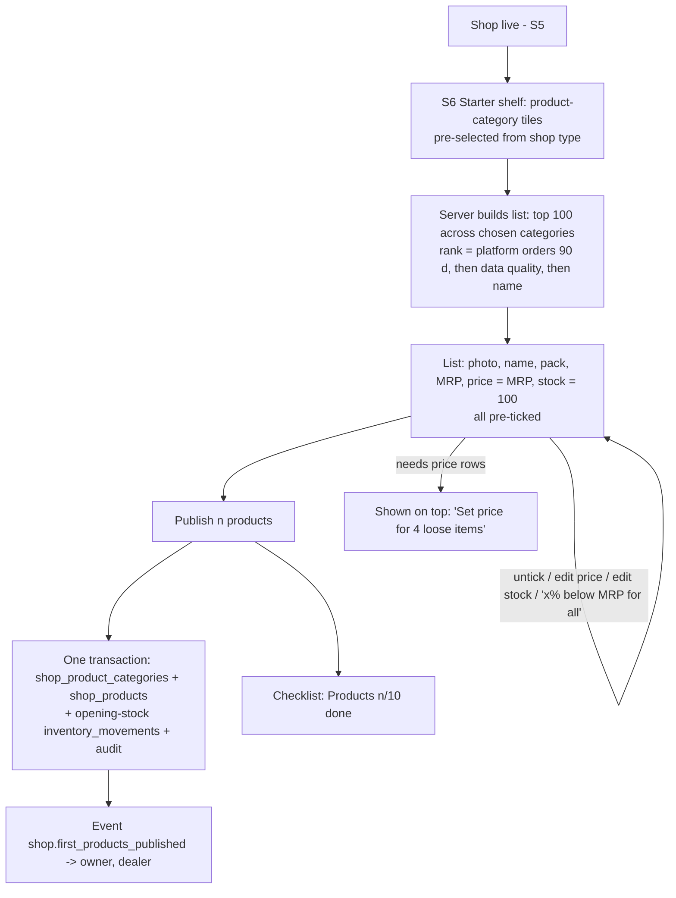
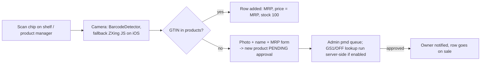
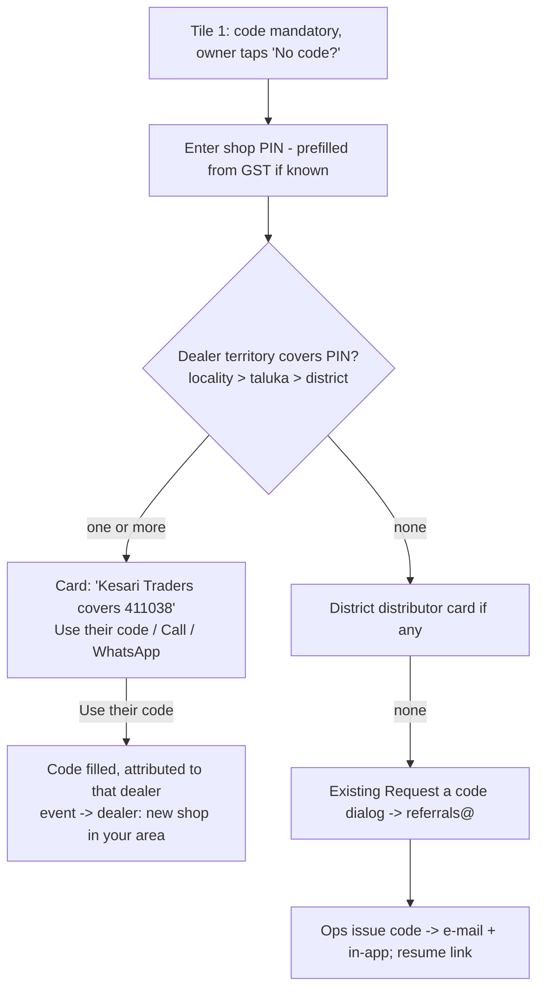
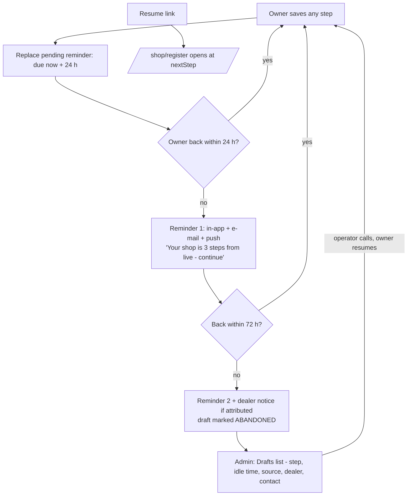
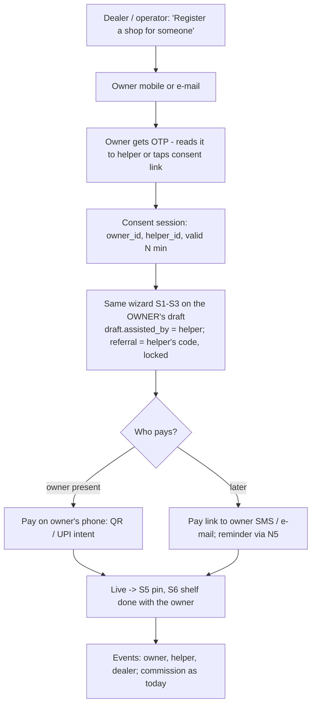
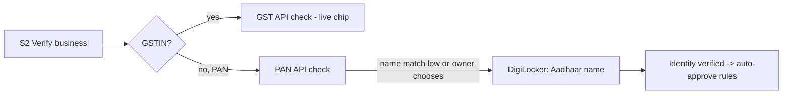

# Shop onboarding — Phase 2 ("Next") flow analysis

05-Nov-2026, 23.40 IST. **Analysis only — no code changed.** For owner approval before any build.

Builds on the Phase A pack (`docs/onboarding-benchmark/`: current-flow, competitor-benchmark,
gap-analysis, proposed-flow) and the owner's answers of 05-Nov-2026, 23.30 IST (D1 yearly fee, D2 starter
shelf 100 × stock 100, D3 e-mail as one line, D4 bank before payout + banner, D5 KPIs from sign-in).
Phase 1 (the quick wins G2, G3, G5, G6, G10, G11, G13, G14, G20, G21, G24, G27, G28, G29) is being built in
another session on `feat/onboarding-phase-b-2026-11`; this document covers the **"Next (2–4 weeks)"** list,
items 14–21 of gap-analysis §2.

Code read at `883a8c97` (main, 05-Nov). File references are relative to the repository root.
"Inferred" = read from code structure, not run.

> **Update 05-Nov-2026 (from the Phase 1 session).** Phase 1 (`feat/onboarding-phase-b-2026-11`, not yet
> pushed) already ships: the starter shelf (`src/server/services/starter-shelf.ts`, rule `starterShelf`
> {size 100, defaultStock 100}, UI `starter-shelf.tsx` on the Products tile), the "Finish set-up" checklist
> (`shop-setup-checklist.ts`, `setup-checklist.tsx` on `/shop`: pin, categories, products n/10, bank,
> delivery, documents), the D4 bank banner, first-products notices, and the step funnel
> (`shop_onboarding_steps`, migration 0145, `/admin/onboarding-funnel`). Wave 1 therefore **extends** these:
> N1 shrinks to checking the ranking (Q1) and opening-stock ledger rows; N8 to the delivery-mode screen and
> pennyless bank check behind the existing checklist rows; N5 reads the last step from
> `shop_onboarding_steps`; N2 (barcode) is new. Wave 1 starts once Phase 1 is staging-verified.

## 0. Summary

| # | Item (gap) | What the code already has | What is missing | Effort | Blocked by |
|---|---|---|---|---|---|
| N1 | Starter shelf + MRP (G16, G17) | `fillInventoryFromCategory` lists a whole product category at **MRP, stock 100** in one transaction | Wizard tile picks *business* categories, not *product* categories; no top-N, no pre-tick list, no opening-stock ledger rows | **S–M** | Phase 1 merge (same wizard file) |
| N2 | Barcode scan to add a product (G16) | POS camera scanner (`BarcodeDetector`); `products.gtin` / `barcode` | Shop-side "scan → add"; iOS has no `BarcodeDetector`; GS1 / OFF lookup is admin-only and off | **S–M** | — |
| N3 | Hindi + Marathi (G25) | `tr()` / `L()` + `gk_lang` cookie (board) | ≈ 300 wizard / sign-in / dialog strings; e-mail templates English-only; no user language column | **M** | Translator review |
| N4 | Referral help by PIN (G4) | `geo_area_pincodes` → `geo_areas` → `dealer_territories` → `activeCodeFor` | A "dealer for PIN" lookup and the "No code?" panel | **S** | Owner decision Q2 |
| N5 | Abandon + resume + admin drafts (G22) | Drafts saved per step; `ABANDONED` status exists (never written); `(status, updated_at)` index | Idle detection, reminder, admin list | **S** | Owner decision Q3 |
| N6 | One assisted mode (G23) | Dealer and operator flows with owner OTP consent | Both are flat forms that skip the wizard's GST prefill, documents, pin, shelf; wizard assumes actor = owner | **M** | — |
| N7 | DigiLocker + scan-first (G8, G9) | Rider DigiLocker (Sandbox.co.in, Aadhaar only); on-device OCR | Scan not default on phones; DigiLocker tables / service rider-specific | Scan **S** · DigiLocker **M** | Live KYC keys (D6) |
| N8 | Bank + delivery as checklist steps (G18, G19) | Payout cycle already holds `BANK_NOT_VERIFIED`; pennyless Cashfree bank check (rule off); delivery fields | No owner toggle for delivery after registration; pennyless check off | **S** | Cashfree verification keys |
| N9 | SMS mobile OTP (G1) | OTP service with provider slot; rate limits | No SMS vendor, no DLT templates | **M** + vendor lead time | SMS vendor + DLT (owner) |

Recommended order (§10): **Wave 1** N1, N2, N8, N5 → **Wave 2** N4, N6, N3 → **Wave 3** (vendor-gated) N9, N7-DigiLocker.

---

## N1. Starter shelf + MRP (G16, G17)

### Today
- Wizard tile "Category" → `ShopCategoryStep` (`src/components/registration/onboarding-wizard.tsx:1146-1170`) →
  PUT `/api/shops/{id}/categories` → `setShopCategories` (`src/server/services/shop-categories.ts:236`). This
  stores **business categories** (`shop_categories` / `shop_category_mapping`). It does **not** touch
  `shop_product_categories`, so no product is added.
- Tile "Products" (`onboarding-wizard.tsx:485-495`) is two links: Excel import and product manager.
- The bulk path already exists elsewhere: POST `/api/shops/[id]/product-categories` → `addCategoryToShop`
  (`src/server/services/product-categories.ts:615`) → `fillInventoryFromCategory` (`:554`) lists **every**
  APPROVED product of the product category, stock = rule `categoryFillStock` (**100**,
  `src/server/config/rules.ts:909-912`), price = **MRP**; LOOSE or no-MRP products come back as `needsPrice`.
  Batches of 500, one transaction, ON CONFLICT DO NOTHING. Used by `shop-product-categories-manager.tsx`.
- Gaps in that path: no top-N cap, no per-product choice, **no `inventory_movements` opening-stock rows**
  (the Excel import writes them, `product-import.ts:1020-1065`), no stock-alert evaluation.
- No popularity signal on products or the product master; the only "popular" logic is order-based
  (`mostOrdered()`, `src/server/services/home-discovery.ts:97`). MRP lives on `products.mrp_paise`; shops
  have no MRP field of their own (correct — MRP is the product's).

### Target flow

### Screen spec (Tile Board)
- **Phone:** category tiles (2 columns, ticks), then a sticky summary bar "100 products · ₹ at MRP · stock 100
  each · Publish". Rows are compact cards; price and stock are inline number fields (numeric keypad);
  a "Scan barcode" chip at the top (N2). "Needs price" rows pinned first with a red badge.
- **Desktop:** two panes — categories left, table right with bulk actions (tick all, % below MRP, set stock).
- Pending-review shops can build the shelf; it is saved as a draft shelf and published on approval
  (proposed-flow S5).

### Build notes
- New `starterShelf(shopId, categoryIds, limit=100)` read: products in those categories, APPROVED, ranked;
  reuse `fillInventoryFromCategory` insert logic with an explicit product-id list instead of "all".
- Map shop type → default product categories (pmd `category.gokesari_department` already keys by shop type).
- Write opening-stock ledger rows (match the Excel import) so stock reports agree.
- Rule: `starterShelf { enabled, limit: 100, defaultStock: 100 }` (D2), admin-editable.
- Wizard file is being changed by Phase 1 (tiles renumbered to 8) → **start N1 after Phase 1 merges**.

### Risks
- Product counts per category on production are unknown (seed has 2–4 per category). If a category has few
  APPROVED products with MRP, the shelf is thin → show the count on each tile before the owner picks.
- 100 rows on a phone: render virtualised; publish is one request (≈ 100 inserts, well inside one transaction).

---

## N2. Barcode scan to add a product (G16)

### Today
- Camera scanners: POS (`src/components/billing/pos-screen.tsx:171`, browser `BarcodeDetector` + getUserMedia)
  and pickup QR (`pickup-qr-scanner.tsx`, jsQR, QR only).
- **`BarcodeDetector` is not available in Safari / iOS WKWebView** (inferred from platform support) → the
  iOS app and iPhone Safari get no scanner today.
- GS1 / Open Food Facts lookup: POST `/api/pmd/sources/lookup`, permission `PMD_IMPORT` (admin only), writes to
  pmd staging, both sources off (`rules.ts:1413-1414`).

### Target flow

### Build notes
- One shared `<BarcodeScanner>` (BarcodeDetector first, ZXing fallback, manual entry last); reuse in POS.
- Shop-side lookup reads `products.gtin` / `barcode` only (no pmd write, no admin permission).
- "Not found" creates a product request; the existing pmd source lookup runs from the admin side.
- Test inside the Android WebView and iOS WKWebView (camera permission prompt, `mediaCapturePermissionGrantType`
  is already set in `mobile/src/App.tsx:401-404`).

---

## N3. Hindi + Marathi for the whole onboarding (G25)

### Today
- `src/lib/board/i18n.ts`: `gk_lang` cookie, `tr(text, lang)`, `L(en, hi, mr)`, `UI` dictionary; server read
  `getBoardLang()`; switch `setLanguageAction`. No server imports, so usable in the wizard.
- Not used by: wizard (≈ 200–250 strings, `onboarding-wizard.tsx`, 1,474 lines), sign-in card (10–15),
  referral dialog (25–30), category picker (≈ 10). `/sell` already promises हिन्दी / मराठी.
- E-mails: `templates.ts` `t(title, body)` English only; **users have no language column**; ≈ 14 onboarding
  templates (≈ 28 strings) + OTP e-mail.

### Target
- Language chips EN / हिं / मरा on every onboarding screen header (same cookie as the board).
- Strings moved to an onboarding dictionary keyed by English text (the board pattern), so missing
  translations fall back to English, never blank.
- `users.preferred_lang` (new column, set when the owner switches language) → templates get a `lang` parameter
  with HI/MR bodies for the 14 onboarding templates; push and in-app use the same.
- OCR stays English (documents are in English); numbers and GSTIN stay Latin digits.

### Build notes
- Phase 1 rewrites wizard copy → translate **after** Phase 1 merges to avoid translating dead strings.
- Machine draft, then native-speaker review (owner to name reviewers — Q7). Marathi and Hindi fonts already
  render in the board (inferred: board uses them).
- A unit test that every onboarding key has HI and MR entries.

---

## N4. Instant referral help by PIN (G4)

### Today
- Toggle `referral_required_shop` (MANDATORY / OPTIONAL) checked by `assertRegistrationReferralCode`
  (`src/server/services/referral-requests.ts:48`) at tile 1 and again at submit.
- When mandatory and the owner has no code, the only way is the "Request Referral Code" dialog → e-mail to
  referrals@gokesari.com + SUPPORT notice → ops issue a code at `/admin/referral-requests` → e-mail back.
  The owner waits (hours or days).
- Data to do better exists: `geo_area_pincodes` (PIN prefix → area, longest prefix wins) → `geo_areas`
  (STATE > REGION > DISTRICT > TALUKA > LOCALITY) → `dealer_territories` (dealer ↔ area, not exclusive) →
  `dealers` (APPROVED, `mobileE164`) → `activeCodeFor(dealerId)` (`src/server/dealers/codes.ts`). Helpers
  `areaForPincode`, `districtCodeForPincode` (`src/server/services/geo-areas.ts:118, 140`). No function joins them.
  Dealers have no coordinates → "nearest" means **territory match**, most specific area first.

### Target flow

### Build notes
- `dealersForPincode(pin)` read; tie-break by dealer activity (shops attributed in 90 days) then oldest.
- Show dealer business name and city; **mobile number only to a signed-in visitor** and through a call button
  (no number on an anonymous page) — Q2.
- Event `referral.dealer_suggested_used` → dealer notice; counts in the funnel (source = "PIN suggestion").
- Abuse: one suggestion use per draft; rate-limit the lookup per IP like the request dialog.

---

## N5. Abandoned registrations: detect, remind, resume, admin list (G22)

### Today
- `shop_registration_drafts` (`src/server/db/schema.ts:10785`): OPEN / SUBMITTED / COMPLETED / ABANDONED —
  **ABANDONED never written**. `updatedAt` bumped on every step; index `(status, updated_at)` fits an idle
  query. `nextStep` is computed (`toWizardView`, `shop-registration-wizard.ts:300-317`), not stored.
- Resume works (`findOpenDraft`, `lockOpenDraft`). No admin view of drafts.
- **No delayed-event mechanism**: `notification_deliveries.nextAttemptAt` is for retry back-off only;
  `NotifyInput` has no send-after.

### Options for "idle 24 h" without a new cron

| Option | How | Verdict |
|---|---|---|
| A. Scheduled notice (recommended) | Add `send_after` to `notification_deliveries`. Each saved step **replaces** the draft's pending reminder with one due in 24 h (idempotency key `draft-idle:{id}`). The existing every-minute `notification-retry` sender delivers it when due; submit / pay cancels it. | Event-driven: the reminder is created by the owner's own step, delivered by the existing sender. Reusable later (first-order nudges, renewal) |
| B. Step in an existing job | Query OPEN drafts idle > 24 h inside hourly `auth-housekeeping` or daily `shop-document-follow-up`; emit `shop_registration_draft.idle` | Simpler, but it is polling — against the brief's "no cron" spirit |

### Target flow

### Build notes
- Resume link = `/shop/register` (signed-in) — no token in the URL; sign-in returns to the same step.
- ABANDONED is a label, not an end: any later step flips it back to OPEN.
- Admin `/admin/shops/drafts`: filters (step, idle > 1 d / 3 d / 7 d, district, source), owner contact,
  "Call" logged to the audit trail; also feeds the Phase 1 funnel (G27).
- Owner opt-out: stop reminders link in the e-mail.

---

## N6. One assisted mode for dealers and operators (G23)

### Today
- **Dealer** (`src/server/dealers/assisted.ts`): owner name / mobile / e-mail → OTP to owner (SMS, else e-mail)
  → owner account found or created → flat form → `registerShop(privileged)`; dealer code attached; owner pays
  later from own account. Routes `/api/dealer/assisted…`, permission `DEALER_PORTAL`.
- **Operator-limited** (`src/server/services/operator-limited.ts`): e-mail OTP consent → flat form →
  `submitOnboardedShop` → fee link or in-session checkout; `sweepOnboardingFees` every 5 min.
- Both flat forms skip: draft / resume, live GSTIN-PAN check with prefill, documents-later choice, FSSAI,
  map pin, categories, starter shelf. Wizard routes need `SHOP_CREATE` (dealers and operator-limited lack it,
  `src/server/authz/permissions.ts:535-563`) and always use `actor.id` as owner.

### Target flow

### Build notes
- Wizard services take `(actor, ownerId)`; permission check = `SHOP_CREATE` **or** a valid consent session
  for that owner. Drafts get `assisted_by_user_id`, `assisted_role`.
- Helper sees only the draft he started; every helper action audited with both ids.
- Keep the two old flows behind a flag until the new one passes tests, then retire them (Q8).
- Commission and attribution unchanged (`attributeShopToCode`, `recordShopAttributionSafely`).

---

## N7. DigiLocker for owners + scan-first on phones (G8, G9)

### Today
- Scan: `src/components/registration/document-scan.tsx`, tesseract.js on-device (English), GSTIN / PAN /
  Udyam / FSSAI; tab defaults to **Type** (`onboarding-wizard.tsx:559`); file input with
  `capture="environment"`. App: camera permissions declared, no runtime request code; OCR in WebView untested.
- DigiLocker: riders only; Sandbox.co.in adapter fetches **Aadhaar only** (masked number, name); table
  `delivery_partner_kyc_checks` keyed by rider; mock refused on production; app bridge
  `mobile/src/digilocker.ts` (system browser + return link). Shop KYC table `seller_verifications` has no
  AADHAAR type (pg enum).

### Target
- **Scan-first (S):** default tab = Scan on touch devices ≤ 768 px; big "Take a photo" button; Type always one tap
  away; OCR model download (3–5 MB) started when the owner opens the screen, not on capture.
- **DigiLocker (M, vendor-gated):** offer "Verify with DigiLocker" for **no-GST (PAN) shops** and when the PAN
  name match is below threshold — owner's Aadhaar name confirms identity; no Aadhaar number stored (masked +
  blind index, as riders). Needs: AADHAAR in `seller_verifications` enum (migration), a generic
  DigiLocker session service (shared by riders and owners), purpose string per use.

### Decision
- Q5: Is owner Aadhaar needed at all? PAN already verifies by API. Default: **scan-first now; DigiLocker
  only for no-GST shops, after live Sandbox.co.in keys.**

---

## N8. Bank account and delivery as checklist steps (G18, G19)

### Today
- Bank: `/shop/bank-account` (₹1 debit-and-refund via Cashfree; simulator off production; unavailable on
  production without keys). Pennyless **Cashfree Bank Account Verification v2** exists
  (`src/server/services/bank-account-check.ts:153-167`) behind rule `bankAccountCheck.enabled` (**off**).
- **The payout cycle already holds `BANK_NOT_VERIFIED` regardless of the rule** (`src/server/payouts/cycle.ts:593`,
  `batches.ts:152-189`); the rule `requireVerifiedForShopPayouts` only gates the manual settlement route.
- Banner component `bank-account-prompt.tsx` shown only on `/shop/manage/[section]` (D4 banner on `/shop`
  is in Phase 1's scope — check before building).
- Delivery: `shops.deliveryAvailable` (default false), `serviceRadiusKm` 5, `deliveryPincodes`; set only in
  the old registration form — **no owner toggle afterwards** (inferred). Fulfilment chosen per order
  (PICKUP / SHOP_DELIVERY / GOKESARI_PARTNER), rule `fulfilmentOptions` off. Own staff:
  `/shop/delivery-staff`. Wallet rule `shopWallet` off (₹200 minimum).

### Target
- Checklist tile **"Get paid"**: account number + IFSC (or UPI) → pennyless check (instant, name match) →
  Verified chip. ₹1 debit-refund stays as fallback for UPI. Turn `requireVerifiedForShopPayouts` on (D4) so
  manual settlements match the cycle.
- Checklist tile **"How you deliver"**: three tiles — *Own staff* (adds staff, sets `deliveryAvailable`,
  radius slider 1–10 km, map preview), *GoKesari riders* (only where rider coverage exists; shows wallet top-up
  if the wallet rule is on), *Pickup only*. One screen, one save.
- Event `shop.bank_verified`, `shop.delivery_configured` → owner, admin funnel.

### Blocker
- Cashfree verification keys (`CASHFREE_VERIFICATION_*`) on staging and production — owner to confirm.

---

## N9. Mobile OTP by SMS (G1)

### Today
- Sign-in code always by **e-mail** (`src/server/otp/service.ts`), except placeholder-e-mail accounts.
  `SMS_PROVIDER` / `WHATSAPP_PROVIDER` accept only `none` | `mock` (`src/lib/env.ts:182-183`);
  `SmsOtpProvider` is a stub; `dltTemplateId` field unused. **No vendor code, no DLT templates.**
- Rate limits solid: 6 digits, 5 min, 5 attempts, 60 s resend, per-user / per-IP DB limits.

### Target
- Sign-in card: "Mobile number" → SMS OTP (Android auto-read with SMS Retriever hash in the app later) →
  e-mail only if the owner chooses or SMS fails twice; set `phoneVerifiedAt`.
- Code: a vendor adapter (e.g. MSG91 / Gupshup / Kaleyra — owner's choice), DLT template id + sender id per
  message, delivery-receipt webhook, `otp-login-form.tsx` mobile-first.

### External lead time (owner / company)
- DLT registration of ASMY GLOBAL TRADING & CONSULTANCY INDIA PVT LTD as principal entity, header (sender id,
  e.g. GOKSRI), OTP + transactional templates approved — typically 1–2 weeks (unverified estimate).
- Vendor account + KYC. Same BSP can later carry WhatsApp (G26).

---

## 9. Events added in Phase 2 (all through `emitEvent` / `notify`, no new cron)

| Event | Owner | Dealer / referrer | Admin |
|---|---|---|---|
| `referral.dealer_suggested_used` | — | ✓ | — |
| `shop_registration_draft.idle` (reminder 1 / 2) | ✓ resume | ✓ (2nd) | drafts list |
| `assisted.consent_given` / `assisted.shop_submitted` | ✓ | ✓ helper | — |
| `shop.starter_shelf_published` (n products) | ✓ | ✓ | funnel |
| `product.request_created` (barcode not found) / `approved` | ✓ | — | ✓ pmd queue |
| `shop.bank_verified` / `shop.delivery_configured` | ✓ | — | funnel |

## 10. Plan, effort and KPI impact

| Wave | Items | Effort | Starts | KPI it moves |
|---|---|---|---|---|
| 1 | N1 starter shelf, N2 barcode, N8 bank + delivery, N5 abandon / resume | ≈ 1.5–2 weeks | after Phase 1 merges to staging | **First 10 products ≤ 3 min** (today ≈ 10–15 min); first-order readiness |
| 2 | N4 referral by PIN, N6 assisted mode, N3 HI / MR | ≈ 2 weeks | after Wave 1 on staging | Removes the hard stop at tile 1; dealer-led volume; vernacular reach |
| 3 | N9 SMS OTP, N7 DigiLocker | ≈ 1 week each once vendors are live | when vendor / DLT / keys arrive | New-user time to live (≤ 5 min from sign-in) |

Expected after Phase 1 + Phase 2 (GST shop, from the sign-in screen, estimates): screens to live **5–6**
(today ≈ 12), time to live **≈ 4–5 min** (today ≈ 9–12), first 10 products **≈ 2–3 min** (today ≈ 10–15).
To be measured with the Phase 1 step analytics, not assumed.

Every item: website + Android + iOS (WebView shell — web changes ship to both apps; native work only for
the iOS barcode fallback test, camera permission prompts and SMS auto-read), tested on test.gokesari.com
then gokesari.com in an owner-approved window, tracker rows per item.

## 11. Tracker rows (status at 05-Nov-2026, 23.40 IST)

| ID | Item | Status | Owner | Updated (IST) |
|---|---|---|---|---|
| N1 | Starter shelf + MRP | Not started (analysis done) | Claude session | 05-Nov-2026 23.40 |
| N2 | Barcode scan to add | Not started (analysis done) | Claude session | 05-Nov-2026 23.40 |
| N3 | Hindi + Marathi onboarding | Not started (analysis done) | Claude session + reviewers | 05-Nov-2026 23.40 |
| N4 | Referral help by PIN | Not started (analysis done) | Claude session | 05-Nov-2026 23.40 |
| N5 | Abandon / resume / drafts list | Not started (analysis done) | Claude session | 05-Nov-2026 23.40 |
| N6 | One assisted mode | Not started (analysis done) | Claude session | 05-Nov-2026 23.40 |
| N7 | Scan-first + DigiLocker | Not started (analysis done) | Claude session; keys: owner | 05-Nov-2026 23.40 |
| N8 | Bank + delivery checklist | Not started (analysis done) | Claude session; keys: owner | 05-Nov-2026 23.40 |
| N9 | SMS mobile OTP | Not started — needs vendor + DLT | Owner (vendor), Claude (code) | 05-Nov-2026 23.40 |

## 12. Owner decisions needed

| # | Question | Default if not answered |
|---|---|---|
| Q1 | Starter shelf ranking: what makes a product "top"? | Platform orders in the last 90 days, then data quality, then name |
| Q2 | Referral by PIN: may the owner take a covering dealer's code in one tap (dealer is credited), and may the dealer's phone be shown to a signed-in owner? | Yes to both; phone via call button only, never on an anonymous page |
| Q3 | Abandon reminders: when and how many? Mechanism A (scheduled notice) or B (step in an existing job)? | 24 h and 72 h, then stop; dealer told on the 2nd; mechanism **A** |
| Q4 | Assisted mode: who pays? | Owner pays on own phone (QR / UPI) or by link later — helper never pays |
| Q5 | Owner Aadhaar via DigiLocker — needed? | Only for no-GST shops / low PAN name match, after live keys |
| Q6 | SMS vendor and DLT registration — who starts it, which vendor? | Owner starts DLT now (longest lead time); vendor chosen on price |
| Q7 | Who reviews Hindi and Marathi copy? | Owner names one native speaker per language |
| Q8 | Retire the old dealer / operator flat forms once the assisted wizard passes tests? | Yes, after one week on staging with no defects |
| Q9 | Barcode "not found": may an owner create a new product (admin approves before sale)? | Yes |

### Owner answers, 05-Nov-2026, 23.46 IST

| # | Answer |
|---|---|
| Q1 | Rank by platform orders in the last 90 days, then data quality, then name |
| Q2 | One-tap dealer code (dealer credited); dealer phone only through a call button for a signed-in owner |
| Q3 | Reminders at 24 h and 72 h, then stop; dealer told on the 2nd; mechanism A (scheduled notice set by each saved step) |
| Q4 | Owner always pays (own phone QR / UPI, or link later); the helper never pays |
| Q5 | DigiLocker only for no-GST (PAN) shops or a low PAN name match, once live Sandbox.co.in keys exist |
| Q6 | Owner starts DLT registration now; vendor chosen on price; Claude builds the adapter |
| Q7 | Owner will name one native-speaker reviewer each for Hindi and Marathi |
| Q8 | Retire the old dealer / operator flat forms after one week on staging with no defects |
| Q9 | Owner may create a product from an unknown barcode; it goes on sale after admin approval |
