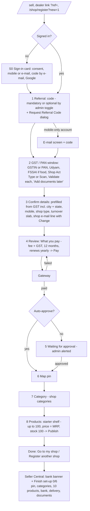
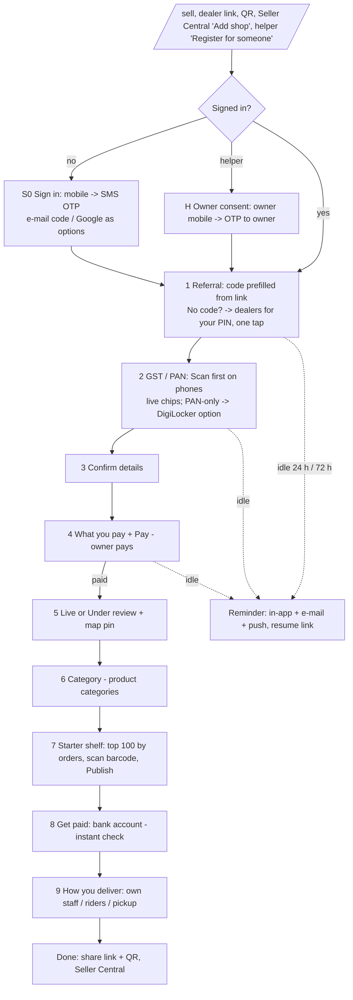

# Shop onboarding — screen flow recheck and Phase 2 implementation plan

06-Nov-2026, 16.05 IST. Rechecked against `main` at `1c017285` (Phase 1 = PR 350, released through PR 353) and
on test.gokesari.com. Builds on [flow-analysis.md](flow-analysis.md) (N1–N9, owner answers Q1–Q9) and
[../phase-1-implementation.md](../phase-1-implementation.md). **Plan only — no code changed.**

## 1. Where things stand

| Item | State |
|---|---|
| Phase 1 (quick wins) | On staging (staging-verified 06-Nov 03.49 IST) and on `main` (gokesari.com) |
| Wizard on test.gokesari.com | On: 8 tiles, "Step 1 of 8 · about 12 min to go live", referral code **mandatory** on staging |
| Wizard on gokesari.com | **Probably off.** Signed-out `/shop/register` goes to the general `/signin` page, not the wizard's own sign-in card. Owner to confirm in Admin → Feature flags (D6) |
| Production KYC provider / keys | Open (D6). Without live keys, auto-approval cannot happen on gokesari.com |
| Phase 2 analysis | Approved with all default answers (05-Nov 23.46 IST); released as docs (PR 351/352) |

**If the wizard is off on production, none of the Phase 1 gains reach real shop owners yet.** Turning
it on needs the production KYC keys first. That is the single biggest lever right now (§6, A1).

## 2. Current screen flow (after Phase 1, wizard on)

**Screens to live:** 5 signed in, 6 for a new owner. **To first products:** 8. Required inputs before payment: ≈ 7.

## 3. Findings from the recheck

| # | Finding | Where | Impact | Fix (work package) |
|---|---|---|---|---|
| F1 | Starter shelf ranks by **how many shops stock a product**, not by orders in the last 90 days (owner's Q1) | `starter-shelf.ts:83-105` | M — new areas with few shops get a weak list | WP1 |
| F2 | Publish adds products **one at a time** (`createShopProduct` per item ≈ 5–6 queries → ≈ 600 for 100), not in one transaction; **no opening-stock ledger rows**; in-shop stock set to 0 | `starter-shelf.ts:151-175` | M — slow on a phone, partial publish on a time-out, stock reports disagree | WP1 |
| F3 | Checklist "delivery" is done only when `deliveryAvailable` is on → a **pickup-only shop can never finish set-up**; "categories" counts shop categories, not product categories | `shop-setup-checklist.ts:51, 60` | M | WP3 |
| F4 | Progress says **"about 12 min to go live"** (referral tile counted as 5 min) — contradicts the ≤ 5 min target and may put owners off | `onboarding-wizard.tsx:118-126` | M | WP5 |
| F5 | Wizard, sign-in card and referral dialog still English only (EN chip shown, text English) | wizard files | H for vernacular owners | WP8 |
| F6 | Mandatory referral on staging is still a hard stop (request → wait for a call) | tile 1 | H | WP6 |
| F7 | `DOCS_READY` step still in the step list though no screen uses it | `shop-registration-wizard.ts:159` | L (clean-up) | WP5 |
| F8 | Production wizard probably off; KYC keys open | Admin → Feature flags | **H** | Owner action A1 |
| F9 | Barcode, bank and delivery screens, abandon reminders, assisted mode, SMS OTP, DigiLocker | — | as in flow-analysis | WP2–WP10 |

## 4. Target screen flow (after Phase 2)

Live stays at screen 5 (owner signed in) and 6 (new owner). Map pin, bank and delivery are **after** going
live and can be skipped to Seller Central; each has a checklist row.

## 5. Screen-by-screen spec (website and app — the app is the same web page)

Common to every screen: Tile Board header, 8-chip progress strip with **minutes from the funnel's median**,
one primary button pinned at the bottom on phones (≥ 48 px), "Save & finish later", EN / हिं / मरा chip,
errors with `role="alert"` tied to the field.

| # | Screen | Fields / actions | States and errors | Phase 2 change | Events |
|---|---|---|---|---|---|
| S0 | Sign in | Mobile number → 6-digit OTP (SMS); "Use e-mail instead"; Google; consent line | Wrong / expired code, resend after 60 s, 5 tries | **WP9** SMS OTP; auto-read on Android later | `auth.otp_sent` |
| H | Owner consent (helper only) | Owner mobile / e-mail → OTP to owner → "Owner agreed" | Consent expires after N min; helper sees only this draft | **WP7** | `assisted.consent_given` → owner, helper |
| S1 | Referral | Code (locked if from link); **No code?** → enter PIN → dealer cards (name, area, Use code, Call) → else Request code | Mandatory and empty → panel, never a dead end | **WP6** | `referral.dealer_suggested_used` → dealer |
| S2 | GST / PAN | **Scan** tab default on phones; GSTIN or "No GST → PAN"; FSSAI (food), Udyam, Shop Act; Validate each; "Add documents later" | Chips: Checking… / Verified / Our team will check / Not found; PAN name match low → "Verify with DigiLocker" | **WP10** scan-first + DigiLocker for PAN-only | `seller.verification_*` |
| S3 | Confirm details | Prefilled card from GST (name, owner, address, city, state, PIN); mobile; shop type; turnover slab; shop e-mail line | Duplicate shop (409); district checks | none (translation only) | — |
| S4 | What you pay + Pay | Fee + GST, 12 months, renews yearly, commission, payouts after bank; Pay | Failed → retry, no money taken; pending → admin alerted | assisted: **pay on owner's phone (QR / UPI) or link** (WP7) | `shop.registration_fee_*` |
| S5 | Live / Under review + pin | Success, shop ID; map pin centred on GST address | Under review: reason + time promise; pin allowed | none | `shop.approved` |
| S6 | Category | Product-category tiles pre-selected from shop type, product count on each tile | Thin category (< 10 products) shown with its count | **WP1** use product categories directly | — |
| S7 | Starter shelf | Up to 100 pre-ticked rows: photo, name, pack, MRP, price (= MRP), stock (100); "% below MRP for all"; **Scan barcode**; Publish | Price > MRP refused per row; loose items need a price; not-found barcode → new-product form (admin approves) | **WP1** ranking + one-transaction publish; **WP2** barcode | `shop.first_products_live`, `product.request_created` |
| S8 | Get paid | Account no. + IFSC (or UPI) → instant check → Verified; "Later" | Name mismatch → review; banner stays until verified | **WP3** | `shop.bank_verified` |
| S9 | How you deliver | Three tiles: Own staff (add staff, radius 1–10 km), GoKesari riders (where covered; wallet top-up if rule on), Pickup only | — | **WP3** | `shop.delivery_configured` |
| D | Done | Share link, WhatsApp share, QR poster; Go to Seller Central; Register another shop | — | share card | — |
| — | Reminders (background) | 24 h and 72 h after the last saved step; dealer told on the 2nd; stop link | Any new step cancels and reschedules | **WP4** | `shop_registration_draft.idle` |
| — | Admin | Drafts list (step, idle time, source, dealer, contact); funnel (Phase 1) | — | **WP4** | — |

## 6. Implementation plan

### Work packages

| WP | Scope | Main files | Migration | Est. (dev days) | Depends on |
|---|---|---|---|---|---|
| **WP1** Starter shelf fixes (F1, F2, S6) | Rank by platform orders 90 d → data quality → photo → name; publish all picks in **one transaction** with batch insert, opening-stock `inventory_movements` rows, in-shop stock = online stock; Category step uses product categories with counts | `starter-shelf.ts`, `product-categories.ts`, `catalogue.ts`, wizard Category step | — | 2 | — |
| **WP2** Barcode scan | Shared `<BarcodeScanner>` (BarcodeDetector → ZXing fallback for iPhone → type the number); shop lookup by `products.gtin` / `barcode`; not found → new-product request (PENDING, admin approves, owner notified) | new `components/barcode-scanner.tsx`, `api/shops/[id]/barcode-lookup`, product-request service; reuse in POS | none if product requests reuse `products.approval_status` (to confirm) | 2 | WP1 (shelf UI) |
| **WP3** Get paid + How you deliver (F3) | Two post-live wizard screens S8, S9 and matching checklist rows; pennyless bank check when keys exist, ₹1 fallback; owner delivery toggle + radius + staff; checklist "delivery" done for any chosen mode | wizard, `shop-setup-checklist.ts`, `bank-account-check.ts`, new `shops.fulfilment_mode` or reuse fields (to confirm) | maybe 1 column | 2 | — |
| **WP4** Abandoned registrations | `notification_deliveries.send_after`; each saved step replaces the draft's pending reminder (24 h, then 72 h); sender skips rows not yet due; ABANDONED set at 2nd reminder, cleared by any step; admin drafts list `/admin/shops/drafts` | `notify`, `shop-registration-draft.ts`, `onboarding-funnel.ts`, new admin page | **0146** `send_after` + index | 2 | — |
| **WP5** Progress estimates + clean-up (F4, F7) | Minutes per tile from funnel medians (fallback 1 min per screen); remove `DOCS_READY` | wizard, `shop-registration-wizard.ts` | — | 0.5 | — |
| **WP6** Referral help by PIN (F6) | `dealersForPincode` (PIN → area → ancestors → territories → approved dealers → active code); "No code?" panel; call button signed-in only; lookup rate limit | `geo-areas.ts`, `dealers/codes.ts`, wizard Referral step, new API | — | 1.5 | — |
| **WP7** One assisted mode | Wizard services take `(actor, ownerId)`; consent session table reused; drafts get `assisted_by_user_id`, `assisted_role`; helper's code locked; owner pays by QR / link; old flat forms behind a flag, retired after one clean week (Q8) | `shop-registration-wizard.ts`, `-draft.ts`, `dealers/assisted.ts`, `operator-limited.ts`, permissions | **0147** draft columns | 4 | WP4 (reminder for unpaid) |
| **WP8** Hindi + Marathi (F5) | Onboarding dictionary (EN / HI / MR) through `tr()`; `users.preferred_lang`; 14 onboarding e-mail / in-app templates + OTP e-mail with a `lang` parameter; test that every key has HI and MR | wizard, sign-in card, referral dialog, starter shelf, checklist, `templates.ts` | **0148** `users.preferred_lang` | 4 + review | WP1–WP7 screens final; reviewers named (Q7) |
| **WP9** SMS mobile OTP | Vendor adapter in `SMS_PROVIDER`, DLT template + sender id, delivery webhook; sign-in by SMS for registered mobiles; `phoneVerifiedAt`; mobile-first sign-in card | `otp/service.ts`, `otp/providers.ts`, `messaging/sms-whatsapp.ts`, `otp-login-form.tsx`, `env.ts` | — | 3 | DLT + vendor (owner) |
| **WP10** Scan-first + DigiLocker (PAN-only) | Scan tab default on phones, OCR model pre-loaded; generic DigiLocker session service (riders + owners); AADHAAR in `seller_verifications`; offered for PAN-only / low name match | `document-scan.tsx`, `rider-kyc.ts` → shared service, `kyc/adapters/sandbox-co.ts` | **0149** enum value | 0.5 + 3 | Live Sandbox.co.in keys (owner) |

Migration numbers are the next free ones today; they will be taken in order at build time.

### Order and releases

| Wave | Work packages | Dev days | Release |
|---|---|---|---|
| 1 | WP1, WP5, WP3, WP4, WP2 | ≈ 8.5 | One PR into `staging` (staging queue), tested on test.gokesari.com, then one production release in an owner-approved window |
| 2 | WP6, WP7, WP8 | ≈ 9.5 + translation review | Same; WP8 last so it translates final screens |
| 3 | WP9, WP10 (DigiLocker part) | ≈ 6 | When DLT / vendor and KYC keys are live; WP10 scan-first ships in Wave 1 if wanted (½ day) |

Every work package, before it is called done:
- **Both sites' rules:** one-database code; no external call inside `db.transaction`; events through `emitEvent` / `notify`, no new cron job.
- **Tests:** integration tests per WP (shelf publish of 100 in one call, barcode found / not found, reminder replaced and cancelled, PIN → dealer, assisted consent and pay link, language fallback, SMS mock); wizard regression (`shop-registration-flow`, `onboarding-wizard-step1/2`, `onboarding-phase-b`); whole suite, typecheck, lint.
- **Negative cases:** bad GSTIN, failed payment, price above MRP, unknown barcode, bank name mismatch, expired consent, resume after drop-off.
- **Browser:** 375 × 812 and desktop on test.gokesari.com; Android and iOS app (camera for scan / barcode, payment return, deep link) on a real phone.
- **Production:** guest checks after release + post-deploy check; signed-in production test only with the owner's go-ahead.
- **Tracker and reports:** tracker rows per WP (Not started / In progress / In test / Done in Prod, IST times) in `Devlopment_Trackers`; test results in `Test_Cases_Tracking`.

## 7. Metrics: before → after

| Measure (GST shop, non-food) | Before Phase 1 | After Phase 1 | After Phase 2 (target) |
|---|---|---|---|
| Screens to live, signed in / new owner | 9 / ≈ 12 | 5 / 6 | 5 / 6 (and no dead end at referral) |
| Screens to first products | ≈ 13 | 8 | 7 (category + shelf merged where the shop type decides) |
| Time to live, new owner | ≈ 9–12 min | measured by funnel | ≤ 5 min (SMS OTP removes the e-mail wait) |
| First 10 products | 10–15 min | < 1 min when MRPs exist | ≤ 3 min incl. barcode for missing items |
| Languages | EN | EN (+ HI/MR board strings) | EN / HI / MR whole flow |
| Abandoned registrations chased | never | funnel shows where they stop | 2 reminders + admin drafts list |

## 8. Owner actions

| # | Action | Needed for |
|---|---|---|
| A1 | Confirm production KYC provider and keys, then turn on `shop_onboarding_wizard_enabled` on gokesari.com (D6) | Phase 1 and 2 reaching real owners |
| A2 | Count live shops without a verified bank account (payouts now held, D4) and tell them | Phase 1 side effect |
| A3 | Add `https://test.gokesari.com/*` to the staging Google Maps key | Map pin on staging |
| A4 | Start DLT registration; choose SMS vendor | WP9 |
| A5 | Cashfree verification keys (staging + production) | WP3 instant bank check |
| A6 | Live Sandbox.co.in keys | WP10 DigiLocker |
| A7 | Name Hindi and Marathi reviewers | WP8 |
