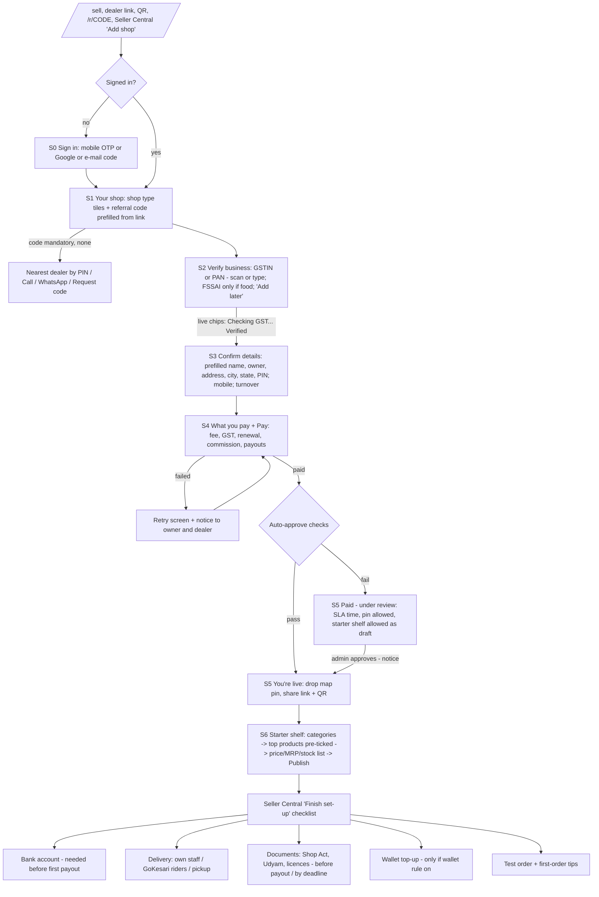

# Shop onboarding — proposed flow (target)

05-Nov-2026, 23.15 IST. **Proposal for owner approval, nothing built yet.** Based on
[gap-analysis.md](gap-analysis.md). Visual language: the approved **"Theme 1 Tile Board"**
([tile-board-2026-10/README.md](../tile-board-2026-10/README.md)) — tiles, chips, live badges, the
56 px compact header, EN / हिं / मरा switch via the `gk_lang` cookie.

## 1. Principles

1. **Live first, paperwork later.** Collect only what's needed to take money and verify the business;
   everything else becomes a checklist item with a clear deadline ("before your first payout").
2. **Never a silent wait.** Every check shows a live status chip; every state change sends a notice.
3. **Never lose an owner.** Each screen saves itself; leaving and returning resumes at the same place;
   payment always returns into the flow.
4. **Products in minutes.** A shop is never live and empty — the starter shelf lists products from the
   product master; the owner only confirms price and stock.
5. **Same screens for everyone.** Self, dealer, operator and "another shop" all use one flow; assisted
   mode only adds the owner's OTP consent.
6. **Business rules unchanged:** referral toggle, auto-approve on verified GST/PAN + paid fee, pending
   path otherwise, dealer commission, wallet model, shop-type mandatory documents (FSSAI for food;
   drug licence / medical registration when `legalDocuments` is on), admin/operator on behalf.

## 2. Target flow

**Screen count, GST-registered non-food shop, signed in:** S1 → S2 → S3 → S4 (+ gateway) → S5 live
= **5 screens to live**, **6 to first products** (was 9 and ≈ 13). New user adds S0 (1 screen, was ≈ 4).

## 3. Screen-by-screen spec

Each screen: compact header, a 5-chip progress strip ("Step 2 of 5 · about 2 min left"), one primary
button pinned at the bottom on phones (≥ 48 px), "Save & finish later" link, language switch. Every
input has a visible label, error tied by `aria-describedby`, alerts with `role="alert"`, focus moves to
the screen heading on change.

### S0 Sign in (new users only)
- **Phone (360–390 px):** one field "Mobile number" → 6-digit OTP (SMS when a vendor is live; e-mail code
  until then) · Google button · "Use e-mail instead". Terms consent as one line under the button.
- **Desktop:** same card, centred, with the "How it works" tiles beside it.
- Goes **straight to S1** — no customer profile, no customer referral check (G2).

### S1 Your shop
- Tile grid of shop types (icons, 2 columns on phone, 4 on desktop; search box for the 50+ types).
- Referral code chip: pre-filled and locked when the visitor came by a dealer / shop link; otherwise a
  field, required or optional per the admin toggle.
- When required and empty: a "No code?" panel — nearest dealer for the PIN (from dealer coverage), Call,
  WhatsApp (when live), "Request a code" (existing dialog → referrals@gokesari.com).
- "Registering for someone else?" (dealer / operator only) → owner's mobile → owner OTP consent.

### S2 Verify business
- Tabs: **Scan** (default on phones, camera) | **Type**. One consent line.
- GSTIN field (or "I don't have GST → PAN" which shows the no-GST declaration). FSSAI appears only for food
  types (required); drug licence / medical registration only when `legalDocuments` requires them.
- Live status chip per line: *Checking… → Verified (name match 96%) / Our team will check / Not found —
  check the number*. Uses the existing event bus; never blocks on PENDING / MANUAL_REVIEW.
- "Add documents later" link (= today's upload-later path) with the rule shown: *"You can sell now. Add
  GST or PAN before your first payout."*
- Shop Act and Udyam move to the checklist (not on this screen).

### S3 Confirm details
- A green "From your GST record" card: shop name, legal name, owner, address, **city, state**, PIN — each
  editable with a pencil; state read-only when from GST.
- Asked: shop mobile (pre-filled from sign-in), turnover slab (pre-selected from GST data when possible),
  optional coupon. Address line 2 / area / landmark under "More".
- Shop e-mail defaults to the account e-mail (change in settings) — subject to decision D3.

### S4 What you pay + Pay
- "What you pay" tile: registration fee + GST = total; **renews after 12 months at ₹…** (or "one-time" if
  the owner decides so); commission per order; payouts (when, to which account); wallet minimum (only if
  the wallet rule is on). Link to Seller Terms.
- Pay button → gateway (UPI first, card, net banking). Gateway returns **to S5** (G13).
- Failure: "Payment didn't go through — no money taken / refund in N days" + Retry; notice to owner and
  dealer.

### S5 You're live (or Under review)
- Live: confetti-free success tile, shop ID, map pin picker (pre-centred on the GST address), "Share your
  shop" (link, WhatsApp share, download QR poster).
- Under review: reason in plain words, review time promise, pin and starter shelf still allowed (saved,
  published on approval). Admin gets an alert with the SLA.

### S6 Starter shelf
- Category tiles (multi-select, pre-selected from shop type).
- List of top products from the product master for those categories (count set by admin, default 100 —
  decision D2), all pre-ticked, each row: photo, name, pack size, **MRP (from master)**, price (default =
  MRP, one-tap "x% below MRP for all"), stock (default from decision D2).
- "Scan a barcode" button adds a product via the existing GS1 / Open Food Facts lookup.
- Publish → products live; "Add more later" goes to the catalogue / Excel import.

### Seller Central "Finish set-up" card (tile board, top of `/shop`)
Live-status rows, each a tile with a badge: Map pin · Products (n / 10) · Bank account (required before
payout) · Delivery mode · Documents (deadline) · Wallet (if on) · Share link + QR · Test order. Hidden
once all done; reachable from the menu afterwards.

## 4. Mobile apps (Android + iOS)

The apps are a WebView shell, so every screen above ships to both apps with the website. App work:
- Commit and test deep links for `/shop/register`, `/r/*`, `/dealer` (Android App Links + iOS Universal
  Links).
- Camera for scan / barcode inside the WebView (permission prompts), location for the map pin, payment
  return into S5 inside the app.
- Bump app version only if native code changes (deep links do); the in-app "new version" banner already
  covers the web part.

## 5. Events, notices and analytics (Phase B2 / B3)

| State change | Owner | Dealer / referrer | Admin / support |
|---|---|---|---|
| Registration started | — | ✓ (if attributed) | — |
| Business verified / needs review | ✓ | — | review queue |
| Payment failed | ✓ (retry link) | ✓ | — |
| Paid, auto-approved (live) | ✓ | ✓ | ✓ |
| Paid, pending review | ✓ (time promise) | ✓ | ✓ alert with SLA |
| Approved / rejected by admin | ✓ | ✓ | — |
| First product published | ✓ | ✓ | — |
| First order received | ✓ | ✓ | ✓ |
| Draft idle 24 h (abandoned) | ✓ resume link | ✓ | — |

All through the existing `emitEvent` / `notify` (in-app + e-mail now; push when on; WhatsApp when a BSP is
signed) — no new cron. Each screen records `started / completed / abandoned / ms spent`; admin funnel:
registration → verified → paid → live → first product → first order, by day, district and source
(self / dealer / operator).

## 6. Target KPIs (B4) and how they will be measured

| KPI | Target | Today (estimate) | Measured by |
|---|---|---|---|
| Time to live, GST shop, signed in | ≤ 5 min | ≈ 6–8 min | step events: S1 start → live |
| Screens to live | ≤ 6 | 9 (≈ 12 new user) | count in the flow |
| First 10 products listed | ≤ 3 min | ≈ 10–15 min | S6 start → 10th product |
| Owner inputs before payment | ≤ 6 | ≈ 10 | spec |
